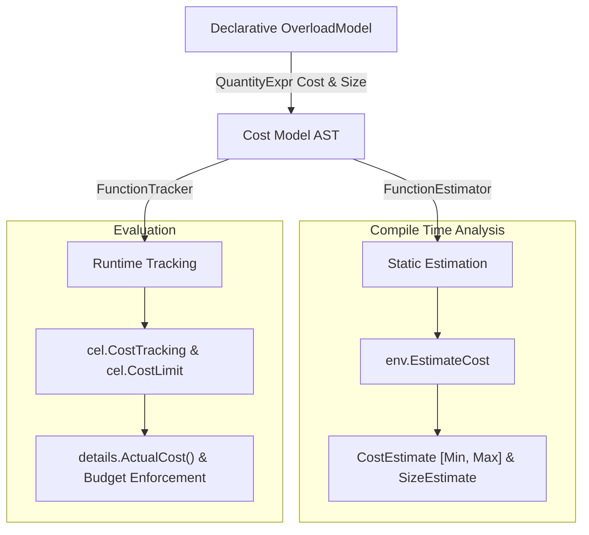

# CEL Cost Model Design & Specification

This document provides a comprehensive specification and usage guide for the
CEL **Cost Model AST** in [cel-go](https://github.com/cel-expr/cel-go). The
Cost Model framework provides a unified, declarative algebraic representation
for both **static cost estimation** and **runtime cost tracking**.

The cost model introduces an AST as a programmatic API for expressing
the algorithm to share during static estimation and runtime cost tracking. While
CEL typically uses expressions to define computation, the cost model is often
specified alongside the function definition and feels more idiomatic. At some
point these cost models may also be expressed as CEL, but for now, they're in
AST form.

* [1. Overview & Motivation](#1-overview--motivation)
* [2. Core Concepts & Architecture](#2-core-concepts--architecture)
* [3. Formal Specification](#3-formal-specification)
* [4. Cost Model AST Primitives & Combinators Reference](#4-cost-model-ast-primitives--combinators-reference)
* [5. Cost Model Examples & Use Cases](#5-cost-model-examples--use-cases)
* [6. Practical Integration Guide](#6-practical-integration-guide)
* [7. Best Practices & Limitations](#7-best-practices--limitations)

---

## 1. Overview & Motivation

CEL expressions execute in diverse environments—from microservices enforcing
admission policies to stream processing engines evaluating millions of events
per second. Protecting compute and memory resources requires two complementary
capabilities:

1. **Static Cost Estimation**: Analyzing an AST before execution to determine
   the theoretical minimum and maximum computational cost ($[Min, Max]$) and
   reject expressions exceeding budget thresholds.
2. **Runtime Cost Tracking**: Measuring the actual computational steps taken
   during expression evaluation and halting execution immediately if a
   configured budget limit is breached.

### The Duality Problem

Prior to the unified Cost Model AST, developers extending CEL with custom
functions had to implement two separate interfaces:
* A static estimator returning `*cost.CallEstimate` (calculating over `AstNode`
  representations and `SizeEstimate` intervals).
* A runtime tracker returning `*uint64` (calculating over concrete `ref.Val`
  inputs and outputs).

This dual-implementation requirement caused code duplication, maintenance
overhead, and subtle inconsistencies between estimated and tracked costs.

### The Unified Cost Model AST Solution

The Cost Model AST in package
[common/cost](https://github.com/cel-expr/cel-go/blob/master/common/cost)
solves this duality. Developers declare the cost and result size equations once
using an algebraic domain-specific expression tree
([`QuantityExpr`](https://github.com/cel-expr/cel-go/blob/master/common/cost/model.go)).
From this single model
([`OverloadModel`](https://github.com/cel-expr/cel-go/blob/master/common/cost/model.go)),
the engine automatically synthesizes:
* A
  [`FunctionEstimator`](https://github.com/cel-expr/cel-go/blob/master/common/cost/estimator.go)
  for compile-time interval analysis.
* A
  [`FunctionTracker`](https://github.com/cel-expr/cel-go/blob/master/common/cost/tracker.go)
  for runtime execution accounting.



### Non-Overflowing Saturating Arithmetic

All cost and size calculations in CEL use unsigned 64-bit integers (`uint64`).
To prevent arithmetic wrapping vulnerabilities:
* `math.MaxUint64` represents an **unbounded** or **unknown** quantity.
* All mathematical operations utilize saturating arithmetic via
  [`common/cost`](https://github.com/cel-expr/cel-go/blob/master/common/cost/cost.go)
  helpers: `SafeAdd` (addition capping at `math.MaxUint64`), `SafeSubtract`
  (subtraction clamping negative differences to `0`), `SafeMultiply`
  (multiplication capping at `math.MaxUint64`), `SafeMultiplyByFactor`
  (floating-point scaling with ceiling rounding), and `SafeCeil`
  (float-to-uint64 ceiling conversion).
* Any sequence of operations on an unbounded input remains safely saturated at
  `math.MaxUint64`.

---

## 2. Core Concepts & Architecture

### Evaluation Contexts

The Cost Model AST evaluates quantity expressions against context interfaces:

* [`TypeContext`](https://github.com/cel-expr/cel-go/blob/master/common/cost/model.go):
  Provides static or runtime type reflection for receiver/target objects and
  positional arguments.
* [`EstimateContext`](https://github.com/cel-expr/cel-go/blob/master/common/cost/model.go):
  Supplies argument size estimates (`Arg(i)`), target size estimates
  (`Target()`), result size estimates (`Result()`), integer literals
  (`ArgValue(i, def)`), and access to the configured
  [`SizingStrategy`](https://github.com/cel-expr/cel-go/blob/master/common/cost/strategy.go).
* [`TrackContext`](https://github.com/cel-expr/cel-go/blob/master/common/cost/model.go):
  Supplies concrete runtime argument sizes (`Arg(i)`), target size
  (`Target()`), result value size (`Result()`), integer argument values
  (`ArgValue(i, def)`), runtime value sizing, and the values themselves
  (`ArgVal(i)`, `TargetVal()`, `ResultVal()`) for the element and key
  projections.

### Overload Definition

Overload models are configured using functional options:

```go
// Global function overload
cost.Overload(overloadID,
    cost.EvalCost(costExpr),
    cost.ResultSize(sizeExpr),
)

// Receiver / member method overload with a prior revision's model
cost.MemberOverload(overloadID,
    cost.EvalCost(costExpr),
    cost.ResultSize(sizeExpr),
    cost.BeforeVersion(1,
        cost.EvalCost(priorCostExpr),
        cost.ResultSize(priorSizeExpr),
    ),
)

// Hand-written estimator and tracker for an overload (or a BeforeVersion entry)
cost.MemberOverload(overloadID,
    cost.ManualCost(customEstimator, customTracker),
)

// Hand-written estimator with declarative runtime tracking
cost.MemberOverload(overloadID,
    cost.EvalCost(costExpr),
    cost.ManualEstimator(customEstimator),
)
```

[`BeforeVersion(version, opts...)`](https://github.com/cel-expr/cel-go/blob/master/common/cost/model.go)
records the options (`EvalCost`, `ResultSize`, `ManualCost`, or
`ManualEstimator`) that priced the overload at revisions `< version`. Every
`BeforeVersion` clause must specify an explicit cost (`EvalCost`, such as
`EvalCost(Const(1))`, `ManualCost`, or `ManualEstimator` which inherits the
enclosing model's `EvalCost` for runtime tracking) and may optionally include
`ResultSize`; omit `BeforeVersion` when an overload's prior model does not
differ from the current one.

### Sizing Strategies

A
[`SizingStrategy`](https://github.com/cel-expr/cel-go/blob/master/common/cost/strategy.go)
governs how container lengths, key sizes, and element sizes are estimated or
observed:
* The
  [`DefaultSizingStrategy`](https://github.com/cel-expr/cel-go/blob/master/common/cost/default_strategy.go)
  sizes strings by code-point count and containers by top-level entry count,
  inspects inline list/map literals, aggregates element/entry sizes, resolves
  branch unions for ternary conditionals (`cond ? a : b`), and queries field
  path hints (`@items`, `@keys`, `@values`).
* The
  [`AggregateSizingStrategy`](https://github.com/cel-expr/cel-go/blob/master/common/cost/aggregate_strategy.go)
  sizes strings by UTF-8 byte length (at least $1$) and containers as $1$ plus
  the recursive sum of their entries' sizes. Custom `FunctionEstimator`s can
  inspect the active strategy's container unit via
  [`cost.ContainerSizingOf(estimator)`](https://github.com/cel-expr/cel-go/blob/master/common/cost/helper.go).
* Sizing strategies can be configured for both estimation and tracking via
  [`cel.CostSizingStrategy`](https://github.com/cel-expr/cel-go/blob/master/cel/options.go)
  at the environment level or
  [`cost.WithSizingStrategy`](https://github.com/cel-expr/cel-go/blob/master/common/cost/strategy.go)
  in package `common/cost`.

### Model Revisions

Corrections to the model would otherwise silently move numbers that existing
deployments budget against, so they land behind a revision. A caller holding
estimates or runtime budgets recorded under an earlier release can pin with
[`cel.CostModelVersion`](https://github.com/cel-expr/cel-go/blob/master/cel/options.go)
(or [`cost.ModelVersion`](https://github.com/cel-expr/cel-go/blob/master/common/cost/version.go)),
review the delta, and adopt the correction deliberately. New callers get the
latest revision by default.

| Version | Corrects |
|---|---|
| `0` | The model as released in `v0.32.0`. |
| `1` | Core `Min()` interval bounds, exact rational `Scale` normalization, `optional` size propagation and qualifier tracking, computed-operand attribute and comprehension variable sizing, and extension (`ext/sets`, `ext/math`, `ext/encoders`, `ext/strings`, `ext/regex`, `ext/network`, `ext/lists`) cost and result-size models. |

Specifically, version `1` corrects:
* **Core `Min()` and `Scale()` (`common/cost`)**: `Min()` computes the exact
  minimum of its operands' intervals (`min(lhs.Min, rhs.Min)`) rather than
  clamping non-zero intervals to a floor of $1$, and `Scale()` normalizes
  nested and multiplied rational factors so products round once. The `Min()`
  correction moves only the lower bound of an estimate, never a charge, so it
  applies at every revision, including version `0`.
* **Optionals (`common/cost`, `interpreter`)**: `optional.of`,
  `optional.ofNonZeroValue`, and `value()` preserve the wrapped value's
  `SizeEstimate` (including container `Key` and `Elem` metadata); `or` and
  `orValue` report the union of their branches' sizes; optional index operators
  (`_[?_]`) record the same `@items` and `@values` field paths as standard
  indexing; and optional field and index qualifiers (`m.?k`, `l[?0]`) charge $1$
  at runtime even when the field or element is absent, matching static
  estimation and non-optional qualification.
* **Core AST & Sizing (`common/cost`)**:
  * Comprehension loop variables over computed (pathless) ranges retain their
    propagated element or key sizes rather than recording bare `@items`,
    `@indices`, `@keys`, or `@values` paths that a caller's `Estimator` could
    override with a smaller bound.
  * Selecting or indexing into a computed expression (such as `[1, 2][0]` or
    `{"a": 1}.a`) includes the attribute traversal cost of $1$ during estimation
    to match runtime tracking.
  * `DefaultSizingStrategy` skips `@items`, `@keys`, and `@values` child size
    hints when a container's maximum size is $0$.
* **Sets, Math, Encoders, and Network (`ext/sets`, `ext/math`, `ext/encoders`, `ext/network`)**:
  * Migrates extension overloads from hand-written estimators and trackers to
    declarative `OverloadModel`s (using `Length` for strategy-independent
    entry/character counts and `BeforeVersion(1, ...)` — which inherits any
    unset `EvalCost` or `ResultSize` from the enclosing model — or
    `cost.ManualEstimator(...)` to preserve version `0` behavior).
* **Lists (`ext/lists`)**:
  * `distinct()`, `sort()`, and `sortBy()` align their self-comparison bounds
    with the runtime tracker's $2.1 \times n^2$ factor (`Max` covers $2.1 \times n^2$
    when element equality rounds to $1$, and `ListsVersion(3)` truncates `Min`
    to match the tracker).
  * `slice()`, `lists.range()`, and `flatten()` widen `Min` to $0$ (or depth $0$
    for `flatten`) when given non-literal bounds or depths instead of treating
    unknown arguments as a fixed `math.MaxUint64` minimum.
  * `ListsVersion(3)` `flatten()` reports the flattened list size as its
    `ResultSize`, and `estimateItemSize` consults `node.ComputedSize().Elem`
    before falling back to path hints.
* **Strings (`ext/strings`)**:
  * `join()` scales the maximum output string length by the target list's
    estimated element size (`Elem`) rather than $1$ character per element.
  * `split()` bounds the resulting list length by $\text{target.Max} + 1$ to
    account for empty-separator and trailing-separator splits.
  * `substring()` widens `ResultSize` to $[0, \text{end} - \text{start}]$ when
    index bounds are not fixed literals.
  * `replace()` bounds `resultMinSize` using the unpadded replacement minimum so
    no-match and empty-replacement results do not overestimate `Min`.
* **Regex (`ext/regex`)**:
  * `regex.extract()` and `regex.extractAll()` include `CallCost` (and the
    `Optional` wrapper's unit `ActualSize` for `extract`), compute `Min` without
    intermediate factor rounding, and bound `extractAll` matches by
    $\text{target.Max} + 1$.
  * `regex.replace()` bounds `ResultSize` as $[0, \text{maxOut}]$ accounting for
    $n + 1$ empty matches and capture-group expansion, and aligns `Min`/`Max`
    with `replaceCostTracker`.

Custom `cost.FunctionEstimator` callbacks can inspect the active model revision
via [`cost.ModelVersionOf(estimator)`](https://github.com/cel-expr/cel-go/blob/master/common/cost/model.go),
and runtime cost trackers expose their configured revision via
[`Tracker.ModelVersion()`](https://github.com/cel-expr/cel-go/blob/master/common/cost/tracker.go).

> [!IMPORTANT]
> Selecting a model version via `cel.CostModelVersion` or `cost.ModelVersion`
> applies to **both static estimation and runtime tracking**, ensuring that an
> expression's estimated bounds and runtime charge are always evaluated under
> the same revision rules.

> [!WARNING]
> **Caveats of `ModelVersion(0)` — switch to `ModelVersion(1)` or higher for soundness.**
> Pinning to version `0` is a temporary migration aid for deployments with
> pre-recorded cost budgets, not a recommended configuration. Because version
> `0` reproduces legacy `v0.32.0` behavior, it retains both severe overestimates
> and **soundness gaps** where the static `Max` estimate can underestimate the
> actual runtime tracked cost ($\text{Actual} > \text{Max}$):
> * **Comprehension loop variables over computed ranges**: A caller's
>   `Estimator` returning a small bound (such as `{0, 0}`) for bare `@items`,
>   `@indices`, `@keys`, or `@values` paths overrides the propagated size of
>   elements produced by a prior step (e.g., `.map(...).exists(...)`), causing
>   each loop iteration's body to be underpriced relative to runtime tracking.
> * **Computed-operand selection and indexing**: Selecting a field or indexing
>   into a computed expression (e.g., `[1, 2][0]` or `{"a": 1}.a`) charges $0$
>   for the traversal during static estimation while the runtime tracker charges
>   $1$.
> * **Extension and `optional` bounds**: Non-literal integer arguments (such as
>   `lists.range(n)`), multi-character `strings.join` elements, and empty
>    separator splits can exceed version `0` static bounds at runtime, while any
>   value wrapped in an `optional` loses its size metadata and saturates upper
>   bounds to `math.MaxUint64`.
>
> Callers should migrate to `ModelVersion(1)` or higher (or leave the version
> unset to use the latest revision) as soon as possible for improved soundness
> ($\text{Min} \le \text{Actual} \le \text{Max}$) and tighter interval accuracy.

---

## 3. Formal Specification

This section specifies the quantity algebra as of [model version 1](#model-revisions).
The algebraic laws in §3.7 and the soundness property in §3.6 are checked by
[`algebra_test.go`](https://github.com/cel-expr/cel-go/blob/master/common/cost/algebra_test.go).

### 3.1 Goals

A cost model must be able to express a call's cost in terms of:

1. **The function**: a constant per-call charge.
2. **Its arguments**: the size, element size, key size, or integer value of
   each argument and of the receiver.
3. **Allocations**: a fixed charge for creating a container, plus a charge
   proportional to what it holds.
4. **Its growth**: linear, product, and polynomial growth in the quantities
   above.
5. **Its result**: the size of what the call returns, so that later calls can
   be priced, and so that a cost can depend on it.

### 3.2 Domain

Let $\mathbb{U} = \{0, 1, \ldots, 2^{64} - 1\}$ and write $\top = 2^{64} - 1$.
$\top$ stands for an unbounded or unknown quantity.

* A **tracked value** is an element of $\mathbb{U}$.
* An **estimate** is a
  [`SizeEstimate`](https://github.com/cel-expr/cel-go/blob/master/common/cost/cost.go):
  an interval $[lo, hi] \subseteq \mathbb{U}$ with $lo \le hi$, plus optional
  `Key` and `Elem` estimates which describe the keys and elements of a
  container. `UnknownSizeEstimate()` is $[0, \top]$.

The primitive operations on $\mathbb{U}$ saturate rather than wrap:

| Operation | Definition | Helper |
|---|---|---|
| $x \oplus y$ | $\min(x + y, \top)$ | `SafeAdd` |
| $x \ominus y$ | $\top$ if $x = \top$, else $\max(x - y, 0)$ | `SafeSubtract` |
| $x \otimes y$ | $\min(x \cdot y, \top)$ | `SafeMultiply` |
| $x \odot f$ | $\lceil x \cdot f \rceil$, clamped to $\mathbb{U}$; see below | `Scale` |

$\oplus$ and $\otimes$ are commutative and associative, and $\otimes$
distributes over $\oplus$. $\ominus$ is truncated subtraction:
$(x \ominus y) \oplus y = \max(x, y)$.

**Scaling changed in version 1.** `Scale(e, f)` is the only operator whose
arithmetic changed between the model released in `v0.32.0` and version 1:

| | `v0.32.0` | Version 1 |
|---|---|---|
| Factor | the `float64` value of `f` | the simplest rational $p/q$ with the same `float64` value, so `0.1` is exactly $1/10$; a factor whose simplest form needs $q > 2^{32}$ is applied in `float64` |
| Product | `float64` multiplication, then ceiling (`SafeMultiplyByFactor`) | exact: $\lceil x \cdot p / q \rceil$ in 128-bit integer arithmetic |
| $x = \top$ | $\lceil \top \cdot f \rceil$, finite for $f < 1$ | $\top$ for every $f > 0$ |
| Nested factors | each `Scale` rounds separately | factors are combined before rounding (§3.5) |

The combinators themselves are not versioned: every model is evaluated with the
version 1 arithmetic at every revision. A model which must keep an earlier
price at earlier revisions states it with `BeforeVersion`, as the standard
`contains` and `matches` models do (§2, [Model Revisions](#model-revisions)).

The arithmetic operations preserve $\top$: a sum, a product by a non-zero
quantity, a positive scaling, or a difference whose minuend is $\top$ is
$\top$. Only operations which select or discard an operand, such as `Min`, a
product by $0$, or a difference whose subtrahend is $\top$, may produce a
finite value from an operand of $\top$.

### 3.3 Sizes and Units

A size is a non-negative integer that the configured
[`SizingStrategy`](#sizing-strategies) assigns to a value. The same strategy
sizes values for estimation and for tracking, so a model's `Arg`, `Target`,
`Result`, and projections always mean the same thing in both interpretations:

| Value | `DefaultSizingStrategy` | `AggregateSizingStrategy` |
|---|---|---|
| `string` | Unicode code points ($0$ for `''`) | UTF-8 bytes ($1$ for `''`) |
| `bytes` | bytes ($0$ for `b''`) | bytes ($1$ for `b''`) |
| `list` | elements | $1$ plus the sum of the elements' sizes |
| `map` | entries | $1$ plus the sum of the keys' and values' sizes |
| message | $1$ | $1$ plus the sum of the set fields' sizes |
| optional | the size of its value; $0$ when empty | the size of its value; $1$ when empty |
| other value with a `Size()`, such as an IP or CIDR | its `Size()` | its `Size()`, at least $1$ |
| any other value | $1$ | $1$ |

Under the aggregate strategy every value has size at least $1$: an empty
optional, a nil message, list or map, and a value whose `Size()` is $0$ each
have size $1$. A container's size is therefore at least $1$ plus its number of
entries, which bounds how many times a comprehension over it can iterate.

### 3.4 Atoms

Argument indices count from $0$ and exclude the receiver of a member overload.

| Atom | Estimate | Track |
|---|---|---|
| `Const(k)` | $[k, k]$ | $k$ |
| `Arg(i)` | size of argument $i$; $[0, \top]$ if absent | size of argument $i$; $0$ if absent |
| `Target()` | size of the receiver | size of the receiver |
| `Result()` | size of the result, from the model's `ResultSize`; $[0, \top]$ if it has none | size of the result |
| `IntArg(i, d)` | $[v, v]$ for a literal $v$; $[0, \top]$ for a non-literal | value of argument $i$, or `d` if it is not an integer |
| `IntTarget(d)` | as `IntArg`, for the receiver | as `IntArg`, for the receiver |

Negative integers read as $0$.

### 3.5 Combinators

For estimates $A = [a_l, a_h]$ and $B = [b_l, b_h]$, and tracked values $a, b$:

| Combinator | Estimate | Track |
|---|---|---|
| `Sum(A, B, ...)` | $[a_l \oplus b_l, a_h \oplus b_h]$ | $a \oplus b$ |
| `Sub(A, B)` | $[a_l \ominus b_h, a_h \ominus b_l]$ | $a \ominus b$ |
| `Mul(A, B, ...)` | $[a_l \otimes b_l, a_h \otimes b_h]$ | $a \otimes b$ |
| `Square(A)` | `Mul(A, A)` | $a \otimes a$ |
| `Scale(A, f)` | $[a_l \odot f, a_h \odot f]$ | $a \odot f$ |
| `Min(A, B)` | $[\min(a_l, b_l), \min(a_h, b_h)]$ | $\min(a, b)$ |
| `Max(A, B)` | $[\max(a_l, b_l), \max(a_h, b_h)]$ | $\max(a, b)$ |
| `Union(A, B, ...)` | $[\min(a_l, b_l), \max(a_h, b_h)]$ | $\max(a, b)$ |
| `Ranged(A, B)` | $[\min(a_l, b_h), b_h]$ | $b$ |
| `AtMost(A)` | `Ranged(Const(0), A)` | $a$ |
| `AtLeastOneQuantity(A)` | $[\max(a_l, 1), \max(a_h, 1)]$ | $\max(a, 1)$ |

The empty `Sum` is $0$, the empty `Mul` is $1$, and the empty `Union` is $0$.

**Scale normalization.** When a model is compiled at version 1, scale factors
are moved outward, and combined as exact rationals, so that each product is
rounded once:

* `Scale(Scale(A, f), g)` becomes `Scale(A, f·g)`.
* `Mul(Scale(A, f), Scale(B, g), C)` becomes `Scale(Mul(A, B, C), f·g)`.
* `Sum(Scale(A, f), Scale(B, f))` becomes `Scale(Sum(A, B), f)`.

A `Sum` is factored only when every term is scaled by the same factor. A sum
with an unscaled term, such as a constant, or with terms of different factors,
rounds once per scaled term: `Sum(Const(1), Scale(A, f), Scale(B, f))` rounds
`A` and `B` separately. Factors whose product has no exact rational form
within the supported range are left nested, and round separately.

**Interval dependency.** Because estimates are intervals, an operand that
appears twice is treated as two independent quantities. `Sub(A, A)` estimates
$[0, a_h - a_l]$ rather than $0$, and `Sub(Sum(A, B), B)` is wider than `A`.
This over-approximates, so it is sound, and the track is exact.

### 3.6 Soundness

For every model and every assignment of values whose sizes lie within the
argument estimates:

$$\text{track} \le \text{estimate}.hi$$

and, except for `Ranged` and `AtMost`, which charge their upper bound:

$$\text{estimate}.lo \le \text{track}$$

The upper bound is the property every model must preserve. An estimate below
the tracked cost lets an expression pass static admission and then exceed its
budget at runtime. For a whole expression, the upper bound assumes:

* size hints consistent with the values, in the units of §3.3;
* under the aggregate strategy, values within its depth and traversal limits;
* strings which are valid UTF-8 and IP addresses without a zone, when the host
  supplies such values directly;
* the default short-circuiting evaluation (`cel.OptExhaustiveEval` evaluates
  and charges both branches of a conditional).

### 3.7 Algebraic Laws

Models which are equal as expressions over $\mathbb{U}$ yield the same
estimate and the same track, so that the form an author chooses does not
change the price.

| Law | Statement |
|---|---|
| Commutativity | `Sum`, `Mul`, `Min`, `Max`, and `Union` are independent of operand order |
| Associativity | the same five combinators may be regrouped, and nested `Sum` or `Mul` flattened |
| Identity | `Sum(A, Const(0)) = A`; `Mul(A, Const(1)) = A`; `Sub(A, Const(0)) = A`; `Scale(A, 1) = A` |
| Annihilation | `Mul(A, Const(0)) = Const(0)` |
| Distributivity | `Mul(A, Sum(B, C)) = Sum(Mul(A, B), Mul(A, C))` |
| Lattice | `Min` and `Max` are idempotent and absorb each other; `Sum` and `Mul` distribute over them |
| Truncated subtraction | `Sub(A, Sum(B, C)) = Sub(Sub(A, B), C)` |
| Scaling | `Scale(Sum(A, B), f) = Sum(Scale(A, f), Scale(B, f))`; `Scale(Mul(A, B), f) = Mul(Scale(A, f), B)`; `Scale(Scale(A, f), g) = Scale(A, f·g)`, where $f \cdot g$ is the exact product of the factors' rational forms |
| Saturation | `Sum`, `Mul` by a non-zero operand, `Scale` by a positive factor, and `Sub` with a minuend of $\top$ yield $\top$ |

The laws hold as stated for operands without `Scale`. With `Scale`,
normalization (§3.5) makes the scaling laws hold, but it rounds a sum once only
when every term shares a factor, so regrouping or distributing over a `Sum` of
scaled terms can move the rounding: `Sum(Scale(A, 0.1), Scale(B, 0.1))` costs
$1$ for $A = B = 5$, while `Sum(Scale(A, 0.1), Scale(B, 0.1), Const(0))` costs
$2$. Both are sound; they differ only in where they round.

### 3.8 Metadata and Container Sizes

A container estimate carries `Elem`, and a map estimate also carries `Key`.

**Container sizes follow the sizing strategy.** `List(len, elem)` and
`Map(n, key, val)` describe a result container by its length and its entry
sizes, and report the size the active strategy assigns to it:

| Strategy | `List(len, elem)` | `Map(n, key, val)` |
|---|---|---|
| `DefaultSizingStrategy` | $len$ | $n$ |
| `AggregateSizingStrategy` | $1 \oplus len \otimes \max(elem, 1)$ | $1 \oplus n \otimes (\max(key, 1) \oplus \max(val, 1))$ |
| any other strategy | $[0, \top]$ | $[0, \top]$ |

`List` sets `Elem` and clears `Key`; `Map` sets both. They are the only way to
describe a result whose entries differ from the operands'. Their track is the
length, which is at most the size under either built-in strategy, so they are
meant for `ResultSize`: inside a cost under the aggregate strategy, their lower
bound exceeds what they charge.

Under the aggregate strategy, a model's result size has an upper bound of at
least $1$, the size of an empty string, bytes value, list, or map, so that a
result which may be empty, such as `'abc'.substring(3)`, is not estimated
below its size.

**Absent metadata.** Whether an absent (`nil`) `Elem` or `Key` means
"unknown" or "none" depends on what the operand is:

* **Scalars** never carry metadata: `Const`, `IntArg`, `IntTarget`, and the
  totals and `Length` of §3.9. (`Const(k)` represents a numeric scalar $k$; a
  constant-length list or map is written `List(Const(k), elem)` or
  `Map(Const(k), key, val)`.)
* **Values** (`Arg`, `Target`, `Result`, `ElemOf`, `KeyOf`) and combinators of
  them may be containers. Such an operand which may be non-empty and states
  neither `Elem` nor `Key` may hold anything, so its element and key sizes are
  unknown. One which states `Elem` but not `Key` is a list, which has no keys.
  An `Arg` or `Target` which the checker typed as a value without elements,
  such as a string, bytes, or a number, is a scalar.
* **Empty containers** hold nothing. A container may be non-empty when its size
  can exceed $0$ under the default strategy, or $1$ under the aggregate
  strategy, which sizes an empty container as $1$.

Combinators propagate metadata as follows:

* `Sum`, `Mul`, `Min`, `Max`, `Union`, and `Ranged` attach metadata when any
  operand states some. They attach the union of the operands' metadata, where
  an operand whose metadata is unknown contributes $[0, \top]$ and a scalar or
  empty container contributes nothing. The result is independent of operand
  order.
* `Sub(A, B)` carries `A`'s metadata, since a difference holds some of `A`'s
  elements and none of `B`'s.
* `Scale(A, f)` and `AtLeastOneQuantity(A)` carry `A`'s metadata.
* `ElemTotal`, `KeyTotal`, and `Length` are scalars and carry none.

### 3.9 Projections

`ElemOf(X)` and `KeyOf(X)` read the value they apply to, so they are defined
only where `X` denotes a value: `Arg(i)`, `Target()`, `Result()`, or an
`ElemOf` or `KeyOf` of those. `ElemTotal(X)`, `KeyTotal(X)`, and `Length(X)`
estimate a quantity from the size of a single value, so `X` must be `Arg(i)`,
`Target()`, or `Result()`. `Validate` rejects other operands at every version.

| Projection | Estimate | Track |
|---|---|---|
| `ElemOf(X)` | `X.Elem`, or $[0, \top]$ | size of the largest element |
| `KeyOf(X)` | `X.Key`, or $[0, \top]$ | size of the largest key |
| `ElemTotal(X)` | by strategy (below) | sum of the element sizes |
| `KeyTotal(X)` | by strategy (below) | sum of the key sizes |
| `Length(X)` | by strategy (below) | the shallow top-level length (`size()` / `cost.ActualSize`): code points of a string, bytes of a bytes value, top-level entries of a list or map, the length of an optional's value ($0$ when empty), $0$ for an error, $1$ otherwise |

The totals are estimated from what the strategy's size of a container means.
With $x = [x_l, x_h]$ the size of `X` and $p$ the element or key size:

| Strategy | `ElemTotal(X)` of a list | `ElemTotal(X)` or `KeyTotal(X)` of a map | Reason |
|---|---|---|---|
| `DefaultSizingStrategy` | $x \otimes p$ | $x \otimes p$ | a container's size is its length |
| `AggregateSizingStrategy` | $[x_l \ominus 1, x_h \ominus 1]$ | $[0, x_h \ominus 1]$ | a container's size is $1$ plus the sizes of its entries |
| any other strategy | $[0, \top]$ | $[0, \top]$ | no relationship is known |

`Length(X)` always reports the shallow top-level length of `X` (`size()` /
`cost.ActualSize`), independent of the sizing strategy. Its estimate depends on
the strategy and on the checked type of `X`, or, for a `Result()` of unknown
type, on whether the estimate states `Elem` or `Key`:

| Strategy | string of size $[x_l, x_h]$ | bytes | list or map | bool, number, duration, timestamp, null | other |
|---|---|---|---|---|---|
| `DefaultSizingStrategy` | $[x_l, x_h]$ | $[x_l, x_h]$ | $[x_l, x_h]$ | $[1, 1]$ | $[x_l, x_h]$ |
| `AggregateSizingStrategy` | $[\lceil x_l / 4 \rceil, x_h]$, or $[0, x_h]$ when $x_l \le 1$ | $[x_l, x_h]$, or $[0, x_h]$ when $x_l \le 1$ | $[\lceil (x_l - 1) / e_h \rceil, x_h]$, with $e_h$ the largest entry | $[1, 1]$ | $[0, \max(x_h, 1)]$ |
| any other strategy | $[0, \top]$ | $[0, \top]$ | $[0, \top]$ | $[1, 1]$ | $[0, \top]$ |

### 3.10 Overloads

An `OverloadModel` pairs an overload ID with a cost expression and an optional
result size expression:

* A **member** overload's receiver is `Target()`, and its arguments are
  indexed from $0$ after the receiver. A **global** overload has no receiver.
* The result size is estimated before the cost, and is available to the cost
  through `Result()` in both interpretations.
* The model's cost covers the call itself. Argument costs are charged
  separately: the estimator adds the arguments' estimated costs. For the
  short-circuiting operators, an operand which may not run counts toward $Max$
  but not $Min$: `&&` and `||` add only the first operand to $Min$; `?:` adds
  the condition and the cheaper branch to $Min$ and the costlier branch to
  $Max$; optional `or` adds the alternative to $Max$ only.

[`OverloadModel.Validate`](https://github.com/cel-expr/cel-go/blob/master/common/cost/validate.go)
rejects a model which cannot be priced consistently. `cel.CostModel` and
`cost.Model` call it at every model version so that a malformed model is
rejected at registration rather than mispriced at evaluation. A model is
rejected when:

* it has no ID, or neither an `EvalCost` expression nor `ManualCost`, or
  combines `ManualCost` with `EvalCost` or `ResultSize`;
* an `Arg`, `ArgElem`, `ArgKey`, or `IntArg` index is negative;
* a projection is applied to something other than a value (§3.9);
* a global overload references the receiver: `Target()`, `TargetElem()`,
  `TargetKey()`, or `IntTarget()`;
* a `Scale` factor is zero, negative, infinite, or `NaN` (use `Const(0)` for a
  free operation);
* `Ranged` has constant bounds in the wrong order;
* the result size expression references `Result()`.

---

## 4. Cost Model AST Primitives & Combinators Reference

The table below catalogs the AST nodes and helper functions provided by
[`common/cost`](https://github.com/cel-expr/cel-go/blob/master/common/cost/model.go):

| Category | Function / Constructor | Description |
| :--- | :--- | :--- |
| **Constants** | `Const(uint64)` | Fixed constant quantity (e.g. `Const(1)` for $O(1)$ operations). |
| **Arguments** | `Arg(i)` | Size of argument at 0-based index `i`. |
| | `ArgElem(i)` | Element size of container argument at index `i`. |
| | `ArgKey(i)` | Key size of map argument at index `i`. |
| | `IntArg(i, defaultVal)` | Non-negative integer value of argument at index `i` (`[val, val]` for a literal integer; unbounded `[0, MaxUint64]` when estimating a non-literal; `defaultVal` at runtime if non-integer). |
| **Receiver / Target** | `Target()` | Size of receiver/target object. |
| | `TargetElem()` | Element size of receiver container. |
| | `TargetKey()` | Key size of receiver map. |
| | `IntTarget(defaultVal)` | Non-negative integer value of receiver (`[val, val]` for a literal integer; unbounded `[0, MaxUint64]` when estimating a non-literal; `defaultVal` at runtime if non-integer). |
| **Result** | `Result()` | Size of the evaluated result value. |
| **Arithmetic** | `Sum(terms...)` | Saturating addition $\sum t_i$. |
| | `Sub(lhs, rhs)` | Saturating subtraction $\max(0, lhs - rhs)$. |
| | `Mul(terms...)` | Saturating multiplication $\prod t_i$. |
| | `Square(expr)` | Squared quantity $expr^2$. |
| **Scaling** | `Scale(expr, factor)` | Multiply expression by constant positive float factor (rounded up). |
| **Intervals & Bounds** | `Min(lhs, rhs)` | Minimum quantity between two expressions. |
| | `Max(lhs, rhs)` | Maximum quantity between two expressions. |
| | `Union(terms...)` | Encompassing interval union $[\min(Min_i), \max(Max_i)]$. |
| | `Ranged(minExpr, maxExpr)` | Composite range with lower bound from `minExpr` and upper from `maxExpr`. |
| | `AtMost(maxExpr)` | Quantity bounded in $[0, Max(maxExpr)]$. |
| | `AtLeastOneQuantity(expr)` | Quantity guaranteed to be $\ge 1$. |
| **Containers** | `ElemOf(expr)` | Size of the largest element of a composite expression. |
| | `KeyOf(expr)` | Size of the largest key of a composite expression. |
| | `ElemTotal(expr)` | Combined size of every element (or map value) of a single container. |
| | `KeyTotal(expr)` | Combined size of every key of a single map. |
| | `Length(expr)` | Shallow top-level length (`size()` / `ActualSize`) of a single value, independent of the sizing strategy. |
| | `List(lenExpr, elemExpr)` | Construct list size estimate with element size metadata. |
| | `Map(sizeExpr, keyExpr, valExpr)` | Construct map size estimate with key and value size metadata. |
| **Standard Macros** | `StringScan(expr)` | Shorthand for `Scale(expr, 0.1)`. |
| | `ListAlloc(elemCount, factor)` | Base allocation cost ($10$) plus scaled element count. |
| | `AllocList(terms...)` | Call dispatch ($1$) + base list allocation ($10$) plus work terms. |
| | `Traversal(expr, factor, alloc)` | Traversal cost with optional fixed allocation cost. |

### Result Size Metadata

A `SizeEstimate` carries a size together with the `Key` and `Elem` sizes of
what it holds:

* **Combinator union**: `Sum`, `Mul`, `Square`, `Scale`, `Min`, `Max`, `Union`,
  `Ranged`, `AtMost`, and `AtLeastOneQuantity` merge the `Key` and `Elem`
  metadata of their operands by taking the interval union across operands that
  may hold elements.
* **Subtraction**: `Sub(lhs, rhs)` inherits **only the minuend's (`lhs`)**
  `Key` and `Elem` metadata, since removing a count or subset of elements
  retains elements only from `lhs`.
* **Widening on unstated containers**: Because a `nil` `Key` or `Elem` is read
  by `KeyOf` and `ElemOf` as `UnknownSizeEstimate()`, attaching operand metadata
  **narrows** the downstream bound relative to leaving it unset. When merging
  multiple operands, if one operand states `Key` or `Elem` metadata and another
  operand is a potentially non-empty container whose metadata is `nil` (for
  example, an unhinted list variable in `Union(knownList, unknownList)`), the
  merged metadata is widened to `UnknownSizeEstimate()` so the unstated
  container cannot under-approximate the combined bound. Scalar expressions
  (`Const`, `IntArg`, `IntTarget`, `Length`, `ElemTotal`, `KeyTotal`, or
  arguments typed as scalars/strings/bytes) and known-empty containers
  contribute no metadata and do not widen another operand's metadata.

> [!WARNING]
> Inheritance is right for a result drawn from its operands, and wrong for one
> that is not. An estimator whose result holds *different* elements — each
> input element expanded, decoded, or joined — must declare them with
> `List(lenExpr, elemExpr)` (which sets `Elem` and clears `Key`) or
> `Map(sizeExpr, keyExpr, valExpr)` (which sets both `Key` and `Elem`). Leaving
> the operands' element size attached to a result whose elements are larger
> understates every downstream estimate.

### Element, Key, and Length Projections

`ElemOf`, `KeyOf`, `ElemTotal`, `KeyTotal`, and `Length` — and the `ArgElem`,
`ArgKey`, `TargetElem`, and `TargetKey` shorthands — read the value they are
applied to, so `ElemOf` and `KeyOf` are defined only over expressions which
denote a value (`Arg(i)`, `Target()`, `Result()`, and nested `ElemOf`/`KeyOf`
projections of those), while `ElemTotal`, `KeyTotal`, and `Length` are defined
over single values (`Arg(i)`, `Target()`, or `Result()`). `ElemOf(Sum(Arg(0), Arg(1)))`
has an estimate but no runtime counterpart;
[`OverloadModel.Validate`](https://github.com/cel-expr/cel-go/blob/master/common/cost/validate.go)
reports it, and `cel.CostModel` rejects the model rather than mispricing the
call. Projections may be nested: `ElemOf(TargetElem())` is the element size of
the inner lists of a list of lists.

`ElemOf` and `KeyOf` report the *largest* element or key, which is what makes
them a bound rather than an average. `ElemTotal` and `KeyTotal` report the exact
combined size of a container's elements/values or map keys, and `Length` reports
the shallow top-level entry/code-point count regardless of whether the active
sizing strategy is `DefaultSizingStrategy` or `AggregateSizingStrategy`.

> [!IMPORTANT]
> Element and key projections (`ElemOf`, `KeyOf`, `ElemTotal`, `KeyTotal`) scan
> the container on every call they are charged for. Unlike the other quantity
> expressions, whose cost does not depend on the values, they are
> $O(n)$ on the evaluation path — roughly $30$ ns per element, against $3$ ns
> for a size read (`BenchmarkProjectionTracking`). Prefer `Arg(i)`, `Target()`,
> or `Length(...)` where the length alone answers the question, and reserve the
> projections for models whose cost genuinely depends on what the container
> holds.

---

## 5. Cost Model Examples & Use Cases

The following catalog demonstrates distinct use cases exercising all features
of the Cost Model AST.

---

### Constant Time Container Indexing

* **CEL Expression**: `items[0]` or `lookup[key]`
* **Complexity**: $O(1)$ evaluation cost; result size inherits container
  element size.
* **Cost Model AST**:
```go
cost.Overload(overloads.IndexList,
    cost.EvalCost(cost.Const(1)),
    cost.ResultSize(cost.ArgElem(0)),
)
```
* **Estimation Behavior**: Cost is fixed at $1$; result size matches the
  element size estimate of `items`.
* **Tracking Behavior**: Incurs $1$ unit of runtime cost.

---

### Linear String Prefix / Suffix Search

* **CEL Expression**: `str.startsWith(prefix)` or `str.endsWith(suffix)`
* **Complexity**: $O(k)$ where $k$ is the prefix/suffix string length.
* **Cost Model AST**:
```go
cost.MemberOverload(overloads.StartsWithString,
    cost.EvalCost(cost.Scale(cost.Arg(0), cost.StringTraversalCostFactor)),
)
```
* **Estimation Behavior**: Scales prefix length estimate by `0.1` (rounded up).
* **Tracking Behavior**: Multiplies actual prefix byte length by `0.1`.

---

### String-to-Bytes Conversion with UTF-8 Expansion Bounds

* **CEL Expression**: `bytes(str)`
* **Complexity**: $O(n)$ traversal cost; resulting byte size expands between
  $1\times$ (ASCII) and $4\times$ (multi-byte UTF-8).
* **Cost Model AST**:
```go
cost.Overload(overloads.StringToBytes,
    cost.EvalCost(cost.Scale(cost.Arg(0), cost.StringTraversalCostFactor)),
    cost.ResultSize(cost.Ranged(cost.Arg(0), cost.Scale(cost.Arg(0), 4.0))),
)
```
* **Estimation Behavior**: If `str` length is $[10, 20]$, byte result size
  estimate is $[10, 80]$.
* **Tracking Behavior**: Incurs traversal cost based on string length; tracks
  byte length.

---

### Bytes-to-String Conversion with Contraction Bounds

* **CEL Expression**: `string(bytesData)`
* **Complexity**: $O(n)$ traversal cost; string character count is bounded
  between $0.25\times$ and $1.0\times$ of byte length.
* **Cost Model AST**:
```go
cost.Overload(overloads.BytesToString,
    cost.EvalCost(cost.Scale(cost.Arg(0), cost.StringTraversalCostFactor)),
    cost.ResultSize(cost.Ranged(cost.Scale(cost.Arg(0), 0.25), cost.Arg(0))),
)
```
* **Estimation Behavior**: A byte slice of length $100$ produces a string size
  estimate of $[25, 100]$.
* **Tracking Behavior**: Runtime cost proportional to scanned byte slice.

---

### String Quoting and Escaping with Delimiters

* **CEL Expression**: `str.quote()` (or `ext.quote(str)`)
* **Complexity**: $O(n)$ scanning; result size adds $2$ delimiter quotes plus
  up to $2\times$ character expansion from escaping.
* **Cost Model AST**:
```go
cost.Overload(overloads.ExtQuoteString,
    cost.EvalCost(cost.Scale(cost.Arg(0), cost.StringTraversalCostFactor)),
    cost.ResultSize(cost.Ranged(
        cost.Sum(cost.Arg(0), cost.Const(2)),
        cost.Sum(cost.Scale(cost.Arg(0), 2.0), cost.Const(2)),
    )),
)
```
* **Estimation Behavior**: For string of length $[5, 10]$, result size estimate
  is $[7, 22]$.
* **Tracking Behavior**: Charge traversal cost; records actual formatted string
  length.

---

### String & Byte Concatenation

* **CEL Expression**: `s1 + s2`
* **Complexity**: $O(m + n)$ memory allocation and copying; result size is
  exactly $m + n$.
* **Cost Model AST**:
```go
cost.Overload(overloads.AddString,
    cost.EvalCost(cost.Scale(
        cost.Sum(cost.Arg(0), cost.Arg(1)),
        cost.StringTraversalCostFactor,
    )),
    cost.ResultSize(cost.Sum(cost.Arg(0), cost.Arg(1))),
)
```
* **Estimation Behavior**: Sums argument lengths for cost scaling and assigns
  $[Min_1 + Min_2, Max_1 + Max_2]$ to result size.
* **Tracking Behavior**: Accurate runtime addition of sizes.

---

### O(1) Shallow List Concatenation

* **CEL Expression**: `list1 + list2`
* **Complexity**: $O(1)$ header creation using persistent slices; result size
  is sum of lengths.
* **Cost Model AST**:
```go
cost.Overload(overloads.AddList,
    cost.EvalCost(cost.Const(1)),
    cost.ResultSize(cost.Sum(cost.Arg(0), cost.Arg(1))),
)
```
* **Estimation Behavior**: Fixed cost of $1$; element count tracked as sum of
  list sizes.
* **Tracking Behavior**: Constant $1$ execution cost.

---

### Linear Collection Membership Search

* **CEL Expression**: `item in list`
* **Complexity**: $O(n)$ scanning of list elements.
* **Cost Model AST**:
```go
cost.Overload(overloads.InList,
    cost.EvalCost(cost.Arg(1)),
)
```
* **Estimation Behavior**: Maximum cost equals the maximum estimated length of
  the list argument.
* **Tracking Behavior**: Actual cost equals the runtime size of the list.

---

### Lexicographical String & Byte Comparisons

* **CEL Expression**: `s1 < s2`, `s1 >= s2`, `b1 == b2`
* **Complexity**: $O(\min(m, n))$ string/byte comparison bounded by the shorter
  input.
* **Cost Model AST**:
```go
cost.Overload(overloads.LessString,
    cost.EvalCost(cost.Scale(
        cost.Min(cost.Arg(0), cost.Arg(1)),
        cost.StringTraversalCostFactor,
    )),
)
```
* **Estimation Behavior**: Takes the minimum upper bound between argument $0$
  and argument $1$.
* **Tracking Behavior**: Charges $\min(len(s1), len(s2)) \times 0.1$.

---

### Substring Containment

* **CEL Expression**: `str.contains(substr)`
* **Complexity**: $O(n \times m)$ worst-case search.
* **Cost Model AST**:
```go
cost.MemberOverload(overloads.ContainsString,
    cost.EvalCost(cost.Mul(
        cost.Scale(cost.Target(), cost.StringTraversalCostFactor),
        cost.Scale(cost.Arg(0), cost.StringTraversalCostFactor),
    )),
)
```
* **Estimation Behavior**: Multiplies scaled target length by scaled search
  string length.
* **Tracking Behavior**: Multiplies actual lengths scaled by string traversal
  cost factor.

---

### Regular Expression Pattern Matching

* **CEL Expression**: `text.matches(r'^[a-z]+$')`
* **Complexity**: $O(n \times m)$ proportional to input text length and
  compiled regex size.
* **Cost Model AST**:
```go
cost.MemberOverload(overloads.MatchesString,
    cost.EvalCost(cost.Mul(
        cost.Scale(
            cost.Sum(cost.Target(), cost.Const(1)),
            cost.StringTraversalCostFactor,
        ),
        cost.Scale(cost.Arg(0), cost.RegexStringLengthCostFactor),
    )),
)
```
* **Estimation Behavior**: Evaluates regex length with factor $0.25$ against
  text length with factor $0.1$.
* **Tracking Behavior**: Tracks concrete runtime sizes of target string and
  regex pattern.

---

### List Slicing with Literal Integer Bounds

* **CEL Expression**: `items.slice(2, 8)`
* **Complexity**: $O(end - start)$ slice allocation; result size bounded by
  both the integer argument delta and the receiver size.
* **Cost Model AST**:
```go
sliceList := cost.List(
    cost.Sub(cost.IntArg(1, 0), cost.IntArg(0, 0)),
    cost.TargetElem(),
)
cost.MemberOverload("list_slice",
    cost.EvalCost(cost.Sum(
        cost.Const(cost.CallCost+cost.ListCreateBaseCost),
        cost.Length(cost.Result()),
    )),
    cost.ResultSize(cost.Ranged(
        sliceList,
        cost.Min(sliceList, cost.Target()),
    )),
)
```
* **Estimation Behavior**: If arguments are literal integers $2$ and $8$,
  `IntArg` estimates them as $[2, 2]$ and $[8, 8]$, so the slice length is
  $[6, 6]$ (and capped above by `Target()`). If an index is a non-literal
  expression, `IntArg` estimates it as $[0, \text{MaxUint64}]$, so
  `Ranged(sliceList, Min(sliceList, Target()))` bounds the result size in
  $[0, \text{Target}()]$ while preserving `TargetElem()` metadata.
* **Tracking Behavior**: Extracts runtime integer arguments, computing
  $8 - 2 = 6$.

> [!NOTE]
> Wrapping `Sub(IntArg(1, 0), IntArg(0, 0))` in `cost.List(..., cost.TargetElem())`
> carries the receiver's element size metadata into the result; without `List`,
> a slice of strings would look like a list of unbounded elements to whatever
> consumes it.

---

### String Repetition with Scalar Multiplier

* **CEL Expression**: `str.repeat(count)`
* **Complexity**: $O(n \times count)$ string construction; result size is
  product of length and count.
* **Cost Model AST**:
```go
cost.MemberOverload("string_repeat_int",
    cost.EvalCost(cost.Scale(
        cost.Mul(cost.Target(), cost.IntArg(0, 1)),
        cost.StringTraversalCostFactor,
    )),
    cost.ResultSize(cost.Mul(cost.Target(), cost.IntArg(0, 1))),
)
```
* **Estimation Behavior**: Multiplies target size interval by $[count, count]$
  when `count` is a literal integer, or by $[0, \text{MaxUint64}]$ when `count`
  is a non-literal expression.
* **Tracking Behavior**: Multiplies target string length by dynamic runtime
  integer parameter.

---

### String Splitting into Substrings

* **CEL Expression**: `text.split(",")`
* **Complexity**: $O(n)$ scanning; result list length is at most $n + 1$, each
  element size at most $n$.
* **Cost Model AST**:
```go
cost.MemberOverload("string_split_string",
    cost.EvalCost(cost.StringScan(cost.Target())),
    cost.ResultSize(cost.List(
        cost.AtMost(cost.Sum(cost.Target(), cost.Const(1))),
        cost.AtMost(cost.Target()),
    )),
)
```
* **Estimation Behavior**: Produces composite `SizeEstimate` for list where
  `Elem` represents substring size bounded by `Target()`.
* **Tracking Behavior**: Runtime size matches the count of split tokens.

---

### Nested List Flattening

* **CEL Expression**: `matrix.flatten()`
* **Complexity**: $O(N \times M)$ element traversal; output list length is at
  most the combined length of the nested lists, and element size is the element
  of the nested list.
* **Cost Model AST**:
```go
flattenedSize := cost.AtMost(cost.Min(
    cost.List(
        cost.Mul(cost.Target(), cost.AtLeastOneQuantity(cost.TargetElem())),
        cost.ElemOf(cost.TargetElem()),
    ),
    cost.Sum(cost.Target(), cost.ElemTotal(cost.Target())),
))
cost.MemberOverload("list_flatten",
    cost.EvalCost(cost.Sum(
        cost.Const(cost.CallCost+cost.ListCreateBaseCost),
        cost.Length(cost.Result()),
    )),
    cost.ResultSize(flattenedSize),
)
```
* **Estimation Behavior**: Bounds the flattened result above by the smaller of
  `List(Mul(Target(), AtLeastOneQuantity(TargetElem())), ElemOf(TargetElem()))`
  and `Sum(Target(), ElemTotal(Target()))`, with a lower bound of $0$ (`AtMost`)
  since inner lists may be empty, keeping the estimate sound under both
  `DefaultSizingStrategy` and `AggregateSizingStrategy`.
* **Tracking Behavior**: Charges the exact runtime flattened list length
  (`Length(Result())`) plus the call and list allocation base cost.

---

### Map Key / Value Projection

* **CEL Expression**: `userMap.keys()` or `userMap.values()`
* **Complexity**: $O(n)$ list allocation; result list length equals map entry
  count (`Length(Target())`), element size equals key/value size.
* **Cost Model AST**:
```go
// map.keys()
cost.MemberOverload("map_keys",
    cost.EvalCost(cost.ListAlloc(cost.Length(cost.Target()), 0.1)),
    cost.ResultSize(cost.List(cost.Length(cost.Target()), cost.TargetKey())),
)

// map.values()
cost.MemberOverload("map_values",
    cost.EvalCost(cost.ListAlloc(cost.Length(cost.Target()), 0.1)),
    cost.ResultSize(cost.List(cost.Length(cost.Target()), cost.TargetElem())),
)
```
* **Estimation Behavior**: Returns a list size estimate whose length matches
  the map entry count (`Length(Target())`) under both sizing strategies and
  whose `Elem` matches the map's `Key` or `Elem`.
* **Tracking Behavior**: Runtime cost reflects map entry traversal and
  allocation.

---

### Pair Zipping into Composite Map

* **CEL Expression**: `zipToMap(keys, values)`
* **Complexity**: $O(\min(len_1, len_2))$ map allocation; composite map entry
  count bounded by smaller input length.
* **Cost Model AST**:
```go
entryCount := cost.Min(cost.Length(cost.Arg(0)), cost.Length(cost.Arg(1)))
cost.Overload("zip_to_map_list_list",
    cost.EvalCost(cost.Sum(
        cost.Const(cost.MapCreateBaseCost),
        cost.Scale(entryCount, 1.0),
    )),
    cost.ResultSize(cost.Map(
        entryCount,
        cost.ArgElem(0),
        cost.ArgElem(1),
    )),
)
```
* **Estimation Behavior**: Constructs composite map `SizeEstimate` carrying key
  size from argument $0$ and value size from argument $1$, with entry count
  bounded by `Min(Length(Arg(0)), Length(Arg(1)))`.
* **Tracking Behavior**: Uses minimum runtime length of both lists plus map
  creation base cost.

---

### Map Entry Copy / Re-Keying with `KeyTotal` and `Length`

* **CEL Expression**: `userMap.invert()`
* **Complexity**: $O(n)$ map entry traversal plus scanning of every key and
  value; result map swaps key and value sizes while preserving entry count.
* **Cost Model AST**:
```go
cost.MemberOverload("map_invert",
    cost.EvalCost(cost.Sum(
        cost.Const(cost.MapCreateBaseCost),
        cost.Length(cost.Target()),
        cost.Scale(cost.Sum(cost.KeyTotal(cost.Target()), cost.ElemTotal(cost.Target())), 0.1),
    )),
    cost.ResultSize(cost.Map(
        cost.Length(cost.Target()),
        cost.TargetElem(),
        cost.TargetKey(),
    )),
)
```
* **Estimation Behavior**: Uses `Length(Target())` for the top-level entry count
  under any sizing strategy, bounds total key and value sizes via `KeyTotal` and
  `ElemTotal`, and swaps `Key` and `Elem` metadata on the result map.
* **Tracking Behavior**: Sums the exact runtime key and value sizes across the
  map entries.

---

### Per-Overload Type-Specific Scaling

* **CEL Expression**: `items.sort()`
* **Complexity**: $O(n^2)$ self-comparison; string and bytes overloads incur an
  additional `StringTraversalCostFactor` ($0.1$) per comparison over scalar
  overloads ($2.0$).
* **Cost Model AST**:
```go
// Scalar element overload (e.g. list(int))
cost.MemberOverload("list_int_sort",
    cost.EvalCost(cost.Sum(
        cost.Const(cost.CallCost+cost.ListCreateBaseCost),
        cost.Scale(cost.Square(cost.Length(cost.Target())), 2.0),
    )),
    cost.ResultSize(cost.Target()),
)

// String element overload (list(string))
cost.MemberOverload("list_string_sort",
    cost.EvalCost(cost.Sum(
        cost.Const(cost.CallCost+cost.ListCreateBaseCost),
        cost.Scale(cost.Square(cost.Length(cost.Target())), 2.0+cost.StringTraversalCostFactor),
    )),
    cost.ResultSize(cost.Target()),
)
```
* **Estimation Behavior**: Dispatches to the overload matching the checked list
  element type and applies its constant rational factor.
* **Tracking Behavior**: Charges the same per-overload factor against the
  runtime list length (`Length(Target())`).

---

### Cartesian Product / Cross Join

* **CEL Expression**: `list1.cross(list2)`
* **Complexity**: $O(N \times M)$ quadratic generation of paired tuples.
* **Cost Model AST**:
```go
pairCount := cost.Mul(cost.Length(cost.Target()), cost.Length(cost.Arg(0)))
cost.MemberOverload("list_cross_list",
    cost.EvalCost(cost.ListAlloc(pairCount, 0.5)),
    cost.ResultSize(cost.List(
        pairCount,
        cost.Sum(cost.TargetElem(), cost.ArgElem(0)),
    )),
)
```
* **Estimation Behavior**: Multiplies list lengths
  $[Min_1 \times Min_2, Max_1 \times Max_2]$; element size is sum of individual
  element sizes.
* **Tracking Behavior**: Accurately computes $len(list1) \times len(list2)$.

---

### Conditional Branch Union & Short-Circuiting

* **CEL Expression**: `cond ? exprA : exprB`
* **Complexity**: Branch selection has $0$ additional cost; result size is
  union of both branches.
* **Cost Model AST**:
```go
cost.Overload(overloads.Conditional,
    cost.EvalCost(cost.Const(0)),
    cost.ResultSize(cost.Union(cost.Arg(1), cost.Arg(2))),
)
```
* **Estimation Behavior**: The result size interval is
  $[\min(Min_A, Min_B), \max(Max_A, Max_B)]$.
* **Tracking Behavior**: Only the evaluated branch is charged at runtime.

---

### Block-Padded Cryptographic Encryption

* **CEL Expression**: `encrypt(plainBytes, key)`
* **Complexity**: Linear encryption cost; output size padded to nearest 16-byte
  AES block boundary.
* **Cost Model AST**:
```go
cost.Overload("crypto_encrypt_bytes_bytes",
    cost.EvalCost(cost.Scale(cost.Arg(0), 1.2)),
    cost.ResultSize(cost.Sum(
        cost.Arg(0),
        cost.Const(16), // Max PKCS#7 padding
    )),
)
```
* **Estimation Behavior**: Estimates encryption cost with factor $1.2$ and
  bounds result size to $len + 16$.
* **Tracking Behavior**: Evaluates actual bytes processed.

---

## 6. Practical Integration Guide

### Step 1: Registering Overload Models in Custom Extensions

To register custom cost models in a CEL environment, construct `OverloadModel`
definitions and provide them via [`cel.CostModel`](https://github.com/cel-expr/cel-go/blob/master/cel/options.go)
(which registers both the static estimator and runtime tracker on the environment):

```go
package myext

import (
    "cel.dev/cel-go/cel"
    "cel.dev/cel-go/common/cost"
    "cel.dev/cel-go/common/types"
    "cel.dev/cel-go/common/types/ref"
)

var MyCustomOverloads = []cost.OverloadModel{
    cost.MemberOverload("string_reverse",
        cost.EvalCost(cost.StringScan(cost.Length(cost.Target()))),
        cost.ResultSize(cost.Target()),
    ),
}

func ExtensionOptions() []cel.EnvOption {
    // Return environment options binding functions and cost models
    return []cel.EnvOption{
        cel.Function("reverse",
            cel.MemberOverload("string_reverse",
                []*cel.Type{cel.StringType},
                cel.StringType,
                cel.UnaryBinding(func(val ref.Val) ref.Val {
                    s := val.(types.String)
                    runes := []rune(string(s))
                    for i, j := 0, len(runes)-1; i < j; i, j = i+1, j-1 {
                        runes[i], runes[j] = runes[j], runes[i]
                    }
                    return types.String(string(runes))
                }),
            ),
        ),
        cel.CostModel(MyCustomOverloads...),
    }
}
```

### Step 2: Static Cost Estimation with Size Hints

Use
[`env.EstimateCost`](https://github.com/cel-expr/cel-go/blob/master/cel/env.go)
to compute estimated cost intervals:

```go
type staticEstimator struct {
    hints map[string]uint64
}

func (e staticEstimator) EstimateSize(node cost.AstNode) *cost.SizeEstimate {
    if node == nil || len(node.Path()) == 0 {
        return nil
    }
    pathKey := strings.Join(node.Path(), ".")
    if size, ok := e.hints[pathKey]; ok {
        sz := cost.FixedSizeEstimate(size)
        return &sz
    }
    return nil
}

func (staticEstimator) EstimateCallCost(
    function, overloadID string,
    target *cost.AstNode,
    args []cost.AstNode,
) *cost.CallEstimate {
    return nil // Use standard and custom OverloadModels
}

func Estimate(env *cel.Env, ast *cel.Ast) (cost.CostEstimate, error) {
    estimator := staticEstimator{
        hints: map[string]uint64{
            "request.auth.claims": 10,
            "request.auth.claims.@keys": 15,
            "request.auth.claims.@values": 30,
        },
    }
    
    // Models not already registered on env via cel.CostModel can be supplied
    // directly with cost.Model, which satisfies both CostOption and TrackerOption.
    return env.EstimateCost(ast, estimator, cost.Model(MyCustomOverloads...))
}
```

### Step 3: Runtime Cost Tracking & Budget Enforcement

Enforce hard computational limits during program execution:

```go
func ExecuteWithBudget(
    env *cel.Env,
    ast *cel.Ast,
    input map[string]any,
    budgetLimit uint64,
) (ref.Val, *cel.EvalDetails, error) {
    prg, err := env.Program(ast,
        cel.CostLimit(budgetLimit),
        cel.CostTracking(nil, cost.Model(MyCustomOverloads...)),
    )
    if err != nil {
        return nil, nil, err
    }

    val, details, err := prg.Eval(input)
    return val, details, err
}
```

---

## 7. Best Practices & Limitations

### Best Practices

1. **Leverage Standard Macros**: Use
   [`StringScan`](https://github.com/cel-expr/cel-go/blob/master/common/cost/model.go)
   and
   [`ListAlloc`](https://github.com/cel-expr/cel-go/blob/master/common/cost/model.go)
   rather than manual arithmetic to ensure consistency across the codebase.
2. **Propagate Element and Key Sizes**: When a function produces a container
   (`list` or `map`), always specify
   [`ResultSize`](https://github.com/cel-expr/cel-go/blob/master/common/cost/model.go)
   with
   [`List`](https://github.com/cel-expr/cel-go/blob/master/common/cost/model.go)
   or
   [`Map`](https://github.com/cel-expr/cel-go/blob/master/common/cost/model.go)
   descriptors so downstream operations (e.g. indexing, comprehensions) can
   accurately estimate size without falling back to unbounded estimates.
3. **Use Subpath Sizing Hints**: Structure size hints using CEL path
   conventions (`variable`, `variable.field`, `variable.@items`,
   `variable.@keys`, `variable.@values`) to enable automatic deep container
   sizing.
4. **Always Rely on Saturating Arithmetic**: Never bypass the `cost.Safe*`
   helpers in custom sizing strategies or quantity expressions to protect
   against overflow vulnerabilities.

### Known Limitations

* **Interval dependency**: Because an estimate is an interval per operand with
  no record of which operands refer to the same quantity, an expression that
  uses an operand twice is estimated as if the two uses varied independently
  (§3.5). The estimate remains a valid upper bound and the runtime charge is
  exact.
* **Hand-written estimators under the aggregate strategy**: A custom
  `FunctionEstimator` that is not an `OverloadModel` may report a synthesized
  container's length as its size, which understates the container's content size
  under `AggregateSizingStrategy`. Prefer declarative `OverloadModel`s using
  `List` and `Map`, or consult `cost.ContainerSizingOf(estimator)`.
* **Dynamically dispatched calls**: When the checker cannot narrow a call to a
  single overload (such as `dyn(l).sort()`), the interpreter selects the
  overload at runtime and the tracker, seeing no static overload ID, charges
  the call as $O(1)$.
* **Aggregate size limits**: `AggregateSizingStrategy` charges a value beyond
  its depth or traversal limits as $2^{32} - 1$ (§3.3), which exceeds estimates
  derived from finite hints.
* **Rounding once per term in sums**: Every quantity is a whole number of cost
  units, so each term of a `Sum` whose terms do not all share a common scale
  factor rounds up before addition (§3.5).

