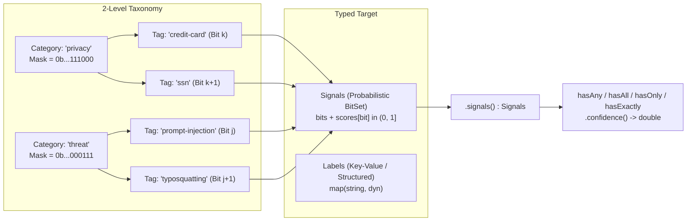

# CEL Content Classification & Signal Tracking Extension (`ext/classify`) Design

## 1. Overview

The `ext/classify` Go submodule (`cel.dev/cel-go/ext/classify`) provides a
content scanning, structural extraction, and bitset-based signal tracking
framework for Common Expression Language (CEL) policies and Go applications,
building on the **CEL AI Attributes & Policy Authoring** architecture
(`cel.expr.ai`, [cel-spec][spec-509]).

`ext/classify` organizes all security, privacy, and safety **signals** into a
two-level **`category` + `tag`** bitset taxonomy (for example,
`category: 'privacy'`, `tag: 'credit-card'`, or `category: 'threat'`,
`tag: 'prompt-injection'`) and models content attributes through two primary
concepts:

1. **`Labels` (Key-Value Metadata with Optional Structured Values)**:
   Key-value pairs whose presence and potential structured value (defaulting to
   string) represent information important to preserve for policy checks—such
   as reviewer attestations (`verified-by`, `verified-date`), governance flags,
   or structured extension metadata (`SKILL.md` `metadata`, MCP `_meta`, and
   structured JSON/YAML `labels`/`metadata`). Labels are queried directly on a
   typed policy target `<T>` (`markdown.Content` for `skill`, `mcp.Tool` for
   `tool`, `a2a.AgentCard` for `agent`, `os.Command` for `command`, or
   `api.Request` for `request`) via **`<T>.labels()`** (`map(string, dyn)`).
2. **`Signals` / `SignalSet` (Probabilistic `Category` & `Tag` Bitset)**:
   Probabilistic bitset values with a confidence score $\in (0.0, 1.0]$
   produced by deterministic detectors, document assertions, or probabilistic
   classifiers (**Llama Guard**, **Cloud Model Armor**, **ShieldGemma**,
   **Jev**, valid-domain typosquatting scorers, or custom user classification
   APIs). A `signal` may also imply the presence of one or more `labels` that
   give a more detailed picture of what is present. Every leaf
   `(category, tag)` maps to a single bit position, and every **`category`**
   maps to the bitwise OR mask of all its registered **`tag`** bits. Signals
   written within CEL expressions as `'<category>:<tag>'` strings are converted
   to bitset tests by a compiler pass or runtime optimization, while strings
   written as just `'<category>'` test only the category bits in the bitset:
   ```cel
   skill.signals()
     .hasAny(['privacy:credit-card', 'privacy:ssn'])
     .confidence() >= 0.70
   ```

[spec-509]: https://github.com/google/cel-spec/pull/509

---

## 2. Core Conceptual Model: `Category` / `Tag` Bitsets



### 2.1. Bitset-Backed `SignalSet` and `Signals.confidence()`

Rather than forcing callers to pass a threshold into `signals(threshold)` up
front—which would require re-computing bitsets for every distinct threshold in
a policy—`<T>.signals()` returns the complete `Signals` wrapper (`SignalSet`)
for the typed target (`markdown.Content`, `mcp.Tool`, `a2a.AgentCard`,
`os.Command`, or `api.Request`), consisting of:
- `bits` (`BitSet`): All active `(category, tag)` signal bits.
- `scores`: Max-merged confidence scores $C_b \in (0.0, 1.0]$ for active bits.

Set queries on `Signals` (`hasAny`, `hasAll`, `hasOnly`, `hasExactly`) return a
`Signals` view (backed by `SignalMatch`) whose `.confidence()` method computes
the exact probabilistic confidence using fuzzy/probabilistic logic with $O(1)$
bitwise short-circuiting:

1. **`signals.hasAny(targets).confidence()` (Disjunction / Max Confidence)**:
   - Represents the likelihood that **at least one** of the specified
     categories or tags is present:
     $$\text{conf}\big(\text{hasAny}(M)\big) = \max_{b \in M} \text{conf}(b)$$
   - **Fast Path**:
     - If `(signals.bits & M) == 0`, returns `0.0` immediately in **1 bitwise
       AND instruction**.
     - Otherwise, iterates only over the set bits in `signals.bits & M` (via
       hardware `TrailingZeros64`) and returns the maximum signal score.

2. **`signals.hasAll(targets).confidence()` (Conjunction / Min Confidence)**:
   - Represents the joint likelihood that **all** required categories or tags
     $M = \{m_1, \dots, m_k\}$ are simultaneously present:
     $$\text{conf}\big(\text{hasAll}(M)\big) =
       \min_{i \in \{1..k\}} \text{conf}\big(\text{hasAny}(m_i)\big)$$
   - **Fast Path**:
     - If for any $m_i$, `(signals.bits & m_i) == 0`, returns `0.0`
       immediately.
     - Deterministic assertions (`1.0`) and probabilistic classifier signals
       compose naturally: if `'safety:defamation'` has confidence `1.0` and
       `'threat:prompt-injection'` has confidence `0.88`, then:
       ```cel
       skill.signals()
         .hasAll(['safety:defamation', 'threat:prompt-injection'])
         .confidence()
       // evaluates to min(1.0, 0.88) == 0.88
       ```

3. **`signals.hasOnly(targets).confidence()` (Allowed-Only Membership)**:
   - Verifies that **no bits outside $M$** are active
     (`(signals.bits & ^M) == 0`) and **at least one** bit in $M$ is active:
     - If `(signals.bits & ^M) != 0` or `(signals.bits & M) == 0`, returns
       `0.0` in $O(1)$; otherwise returns `signals.hasAny(M).confidence()`.

4. **`signals.hasExactly(targets).confidence()` (Exact Set Equality)**:
   - Verifies that **all** required targets $M = \{m_1, \dots, m_k\}$ are
     present (`hasAll(M)`) **and no bits outside $M$** are active
     (`(signals.bits & ^M) == 0`):
     - If `(signals.bits & ^M) != 0`, returns `0.0` in $O(1)$; otherwise
       returns `signals.hasAll(M).confidence()`.

### 2.2. Why Bind `Signals` Queries Once for Monitor vs. Enforce?

Because `hasAny` and `hasAll` return a `Signals` object before thresholding, a
policy can define a single variable for a concern and compare `.confidence()`
against both its **monitoring** threshold and its **enforcement** threshold
without repeating the query:

```yaml
variables:
  - threat_check: >
      skill.signals().hasAny(['threat', 'safety'])
  - financial_pii_check: >
      skill.signals().hasAny(['privacy:credit-card', 'privacy:ssn'])

rules:
  - condition: >
      variables.threat_check.confidence() >= 0.85 ||
      variables.financial_pii_check.confidence() >= 0.70
    effect: deny
  - condition: >
      variables.threat_check.confidence() >= 0.50 ||
      variables.financial_pii_check.confidence() >= 0.40
    effect: confirm
```

Furthermore, `<T>.signalSpans()` (or `<T>.signals().spans()`) returns
`list(classify.SignalSpan)`, where each `SignalSpan` carries its canonical or
vendor `signal` identifier (`category:tag`), `confidence`, optional
`section_id`, and `span` (`classify.Span` with `[start, stop)` code point
offsets, `[start_byte, stop_byte)` UTF-8 byte offsets, and `line` / `column`
coordinates), so raw text ranges are inspected directly via CEL `substring`
(for example, `skill.body.substring(s.span.start, s.span.stop)`).

---

## 3. Policy Taxonomy & Model Output Mappings

Content security policies must express rules in a uniform, model-agnostic
vocabulary without caring whether a signal came from a deterministic detector
(such as `detect.Secrets`), a local open-weight classifier (Llama Prompt Guard
2, Llama Guard, ShieldGemma, Granite Guardian), a hosted moderation API (Google
Cloud Model Armor, OpenAI Moderation), a hosted structured-decision model
(TypeSafe Jev), or a general-purpose LLM prompted as a classifier (Claude,
DeepSeek, Kimi).

`ext/classify` establishes a **Policy Taxonomy** that groups all security,
safety, and privacy signals into standard **`category`** and **`category:tag`**
bitset identifiers. Model-independent metadata, typed target fields
(`markdown.Content`, `mcp.Tool`, `a2a.AgentCard`, `os.Command`, `api.Request`),
and review attestations (`verified-by`, `verified-date`) are decoupled from
probabilistic classifications and queried directly on the typed target and
`<T>.labels()`.

### 3.1. Canonical Policy Taxonomy

| Canonical ID | Scope |
| :--- | :--- |
| `threat:prompt-injection` | System prompt overrides, delimiter/goal attacks |
| `threat:jailbreak` | Adversarial personas, roleplay/encoding bypasses |
| `threat:typosquatting` | Confusable or lookalike domains |
| `threat:malicious-uri` | Phishing hosts, malware links, `javascript:` URIs |
| `threat:exploit` | Shell injections, command execution payloads |
| `threat:cyberattack` | Malware synthesis, vulnerability weaponization |
| `threat:cbrn` | CBRN weapons synthesis or instructions |
| `threat:frontmatter-injection` | YAML directives or delimiter spoofing |
| `safety:hate-speech` | Hatred or disparagement of protected traits |
| `safety:harassment` | Bullying, stalking, intimidation, insults |
| `safety:sexual` | Explicit erotic depictions or solicitation |
| `safety:child-safety` | CSAM / CSAS or child exploitation and abuse |
| `safety:violence` | Graphic gore, weapons, physical harm incitement |
| `safety:self-harm` | Suicide or self-injury instructions/promotion |
| `safety:defamation` | False factual statements harming reputations |
| `privacy:credit-card` | Payment card numbers (PAN) with Luhn check |
| `privacy:ssn` | Social Security and national ID numbers |
| `privacy:phone-number` | E.164 and local formatted telephone numbers |
| `privacy:email` | Validated email address patterns |
| `privacy:secret-key` | Cryptographic keys, API tokens, passwords |
| `privacy:pii` | General personal data when subtype is unknown |

---

### 3.2. Backend Output Mappings

Each backend adapter implements `Classifier` and translates native output into
canonical signals. Facts below come from the vendor documentation listed in
[§3.5](#35-sources). Choices that are ours rather than the vendor's are marked
**proposed**.

**Mapping rules**
- **Fit** describes how a native label relates to its canonical tag:
  *equivalent*, *narrower* (covers part of the tag), *broader* (covers the tag
  plus related content), or *overlaps*. Labels whose definitions differ
  materially are **unmapped**.
- **Unmapped labels** are emitted as `<backend>:<label>` signals, e.g.
  `llama-guard:s8-intellectual-property`. These IDs are not in the
  `Dictionary`, so the scanner records them via
  `SignalBuilder.AddUncategorized`: visible in reports and queryable via
  `.confidence('vendor:tag')`, without setting canonical category bits.
- **Combined detectors** that do not separate prompt injection from jailbreaks
  (Prompt Guard 2 `MALICIOUS`, Model Armor `pi_and_jailbreak`) map to
  `threat:prompt-injection` (**proposed**). Policies that care about either
  should query both tags or the `threat` category.

#### 3.2.1. Backend Summary

- **Llama Prompt Guard 2** (Local; Llama 4 Community License, gated; 22M/86M):
  `BENIGN` / `MALICIOUS` per 512-token window; softmax $P(\text{MALICIOUS})$;
  window span.
- **ProtectAI `deberta-v3-base-prompt-injection-v2`** (Local; Apache-2.0,
  ungated; 184M): binary English prompt-injection label; softmax probability;
  window span.
- **Llama Guard 3 (1B, 8B) & 4 (12B)** (Local / Ollama `llama-guard3`; Llama
  3.2/3.1/4 Community Licenses, gated): `safe` / `unsafe` + violated codes
  (`S1`–`S13` for 1B; `S1`–`S14` for 8B and 4); $P(\text{first token unsafe})$;
  chunk span.
- **ShieldGemma** (Local / Ollama `shieldgemma`; Gemma Terms, gated; 2B/9B/27B):
  `Yes` / `No` per policy prompt; $P(\text{Yes})$ in one scoring pass per
  policy; chunk span.
- **Granite Guardian 4.1** (Local / Ollama `granite4.1-guardian`; Apache-2.0,
  ungated; 8B): `yes` / `no` per criterion; yes/no token probability; chunk
  span.
- **Google Cloud Model Armor** (GCP regional endpoint; free up to 2M
  tokens/month standalone, then $0.10/1M tokens; SCC Premium/Enterprise
  includes 3B tokens/month): per-filter `matchState` and `confidenceLevel`
  bucket (**proposed** lookup), plus SDP findings with `likelihood` and exact
  byte/codepoint spans.
- **OpenAI Moderation** (OpenAI API): 13 `category_scores` in $[0, 1]$ plus
  boolean `categories`; score as-is; chunk span.
- **Claude** (Anthropic API): prompted JSON `{risk_level, categories,
  explanation}` (`risk_level / 3`, **proposed**) and `stop_reason: "refusal"`
  with `stop_details.category`; chunk span.
- **DeepSeek & Kimi** (Vendor APIs; open weights at ~685B and ~1T params): no
  native moderation output; prompted like Claude (`risk_level / 3`,
  **proposed**); chunk span.
- **TypeSafe Jev** (TypeSafe API, hosted early access; $0.042/1M input tokens,
  output free): typed `noul` (yes/no probability), `choice`, and `score`
  questions; `noul` probability as-is; chunk span.

"Window" means the adapter splits each chunk into overlapping windows that fit
the model's token limit, so no text is truncated, and reports each signal with
the `Span` of the window that produced it; "Chunk" means one result per
`Scanner` chunk (`MaxChunkRunes`).

#### 3.2.2. Meta Llama Prompt Guard 2 (22M / 86M)

Source: [Llama Prompt Guard 2 model card][src-pg2].
- Labels a prompt `MALICIOUS` "if the prompt explicitly attempts to override
  prior instructions". Version 2 dropped Prompt Guard 1's separate injection
  label, which Meta found "too broad to be useful".
- 512-token context window; Meta recommends splitting longer inputs into
  segments and scanning them in parallel.
- Meta reports 19.3 ms (22M) and 92.4 ms (86M) per 512-token classification on
  an A100 GPU, and recall at 1% false-positive rate of 88.7% (22M) and 97.5%
  (86M) on its jailbreak benchmark. CPU latency is not published. The 22M model
  is weaker on non-English text.
- Meta notes that fine-tuning on domain-specific prompts reduces false
  positives. This matters for skill scanning, because skill files are
  imperative instructions by design.

| Native label | Canonical ID | Fit |
| :--- | :--- | :--- |
| `MALICIOUS` | `threat:prompt-injection` | Broader (includes jailbreaks) |
| `BENIGN` | — | No signal |

#### 3.2.3. ProtectAI DeBERTa v3 Prompt Injection v2

Source: [ProtectAI model card][src-protectai]. English-only binary
prompt-injection classifier. The card states it "does not detect jailbreak
attacks or handle non-English prompts". Meta's AgentDojo comparison in the
Prompt Guard 2 card reports 22.2% attack prevention for this model versus
78.4–81.2% for Prompt Guard 2; that comparison was run by Meta.

| Native label | Canonical ID | Fit |
| :--- | :--- | :--- |
| Injection | `threat:prompt-injection` | Narrower (English, no jailbreak) |

#### 3.2.4. Meta Llama Guard 3 and 4

Sources: model cards for [Llama Guard 3-8B][src-lg3-8b], [3-1B][src-lg3-1b],
and [4][src-lg4].
- Generates `safe` or `unsafe` and, if unsafe, lists the violated category
  codes. Meta derives a classifier score from "the probability for the first
  token" as the unsafe-class probability. The adapter applies that score to
  every listed code, falling back to a configured default when the serving
  runtime does not expose token probabilities.
- Categories follow the MLCommons hazard taxonomy. Llama Guard 3-1B covers
  S1–S13; 3-8B and 4 add S14. Llama Guard 4 also classifies prompts containing
  images.
- Llama Guard has no prompt-injection or jailbreak category; Prompt Guard
  covers that.

| Code | Native category | Canonical ID | Fit / notes |
| :--- | :--- | :--- | :--- |
| S1 | Violent Crimes | `safety:violence` | Equivalent |
| S2 | Non-Violent Crimes | Unmapped | Fraud, theft, drugs, hacking |
| S3 | Sex-Related Crimes | Unmapped | Trafficking, assault |
| S4 | Child Sexual Exploit | `safety:child-safety` | Equivalent |
| S5 | Defamation | `safety:defamation` | Equivalent |
| S6 | Specialized Advice | Unmapped | Financial, medical, legal |
| S7 | Privacy | `privacy:pii` | Narrower (nonpublic PII) |
| S8 | Intellectual Property | Unmapped | — |
| S9 | Indiscriminate Weapons | `threat:cbrn` | Broader (adds explosives) |
| S10 | Hate | `safety:hate-speech` | Equivalent |
| S11 | Suicide & Self-Harm | `safety:self-harm` | Equivalent |
| S12 | Sexual Content | `safety:sexual` | Equivalent |
| S13 | Elections | Unmapped | — |
| S14 | Code Interpreter Abuse | `threat:exploit` | Narrower (3-8B & 4 only) |

#### 3.2.5. Google ShieldGemma

Source: [ShieldGemma model card][src-shieldgemma]. Each harm type is a separate
policy prompt. The model answers `Yes` or `No` and is run "in scoring mode to
predict the probability that the next token would be `Yes`", so scanning a
chunk against all four policies takes four passes.

| Policy | Canonical ID | Fit / notes |
| :--- | :--- | :--- |
| Sexually Explicit | `safety:sexual` | Equivalent |
| Hate Speech | `safety:hate-speech` | Equivalent |
| Harassment | `safety:harassment` | Equivalent |
| Dangerous Content | Unmapped | Spans firearms, terror, suicide |

#### 3.2.6. IBM Granite Guardian 4.1

Source: [Granite Guardian 4.1 8B model card][src-granite]. Judges content
against one criterion per call and answers `yes` or `no`, with a lower-latency
"no-think" mode. Ships pre-baked criteria and supports user-defined criteria
("Bring Your Own Criteria").

| Criterion | Canonical ID | Fit / notes |
| :--- | :--- | :--- |
| Jailbreaking | `threat:jailbreak` | Equivalent |
| Violence | `safety:violence` | Broader (includes self-harm) |
| Sexual content | `safety:sexual` | Equivalent |
| Harm, Bias, Profanity | Unmapped | Includes unethical behavior |
| RAG / Function Halluc. | Unmapped | Agent quality, not safety risk |

User-defined criteria allow the `Dictionary` descriptions from §3.1 to be
passed as criteria, yielding one yes/no judgement per canonical tag. Accuracy
per criterion must be measured before relying on it.

#### 3.2.7. Google Cloud Model Armor

Sources: [Sanitize prompts and responses][src-ma-sanitize],
[quotas and limits][src-ma-quotas], and [pricing][src-ma-pricing].
- `sanitizationResult.filterResults` is keyed by filter: `rai`,
  `pi_and_jailbreak`, `malicious_uris`, `csam`, and `sdp`. The RAI types are
  `sexually_explicit`, `hate_speech`, `harassment`, and `dangerous`.
- Each result reports `matchState` (`MATCH_FOUND` or `NO_MATCH_FOUND`). RAI and
  prompt-injection matches also report a `confidenceLevel` bucket:
  `LOW_AND_ABOVE`, `MEDIUM_AND_ABOVE`, or `HIGH`. There are no continuous
  scores.
- SDP inspect findings report `infoType`, `likelihood` (e.g. `LIKELY`), and
  both `byteRange` and `codepointRange`, which map directly onto `Span`.
  `malicious_uris` matches list each matched URI, with locations only for UTF-8
  byte input, so the adapter locates each URI in the chunk text and otherwise
  reports the whole chunk.
- Basic SDP scans `CREDIT_CARD_NUMBER`, `FINANCIAL_ACCOUNT_NUMBER`,
  `GCP_CREDENTIALS`, `GCP_API_KEY`, and `PASSWORD` in all regions, plus
  `US_SOCIAL_SECURITY_NUMBER` and `US_INDIVIDUAL_TAXPAYER_IDENTIFICATION_NUMBER`
  in US regions. Advanced SDP uses custom inspect templates and can report
  other infoTypes.
- Filters screen up to 65,536 tokens (prompt injection, RAI, CSAM) or 0.5 MB
  (SDP). Over the limit, a filter reports `EXECUTION_SKIPPED`. The adapter
  treats a skipped filter, or an `invocationResult` of `PARTIAL` or `FAILURE`,
  as an error, so the scan is incomplete rather than clean.
- **Proposed** confidence defaults: `LOW_AND_ABOVE` = 0.5,
  `MEDIUM_AND_ABOVE` = 0.7, `HIGH` = 0.9; SDP `VERY_UNLIKELY` through
  `VERY_LIKELY` = 0.1, 0.3, 0.5, 0.7, 0.9; and 0.9 for matches without a level
  (`csam`, `malicious_uris`). The defaults are configurable and uncalibrated.

| Filter / infoType | Canonical ID | Fit / notes |
| :--- | :--- | :--- |
| `rai` `sexually_explicit` | `safety:sexual` | Equivalent |
| `rai` `hate_speech` | `safety:hate-speech` | Equivalent |
| `rai` `harassment` | `safety:harassment` | Equivalent |
| `rai` `dangerous` | Unmapped | `model-armor:rai.dangerous` |
| `pi_and_jailbreak` | `threat:prompt-injection` | Broader (**proposed**) |
| `malicious_uris` | `threat:malicious-uri` | Equivalent |
| `csam` | `safety:child-safety` | Equivalent |
| SDP `CREDIT_CARD_NUMBER` | `privacy:credit-card` | Equivalent |
| SDP `US_SSN` / `US_ITIN` | `privacy:ssn` | Narrower (US regions) |
| SDP `GCP_*`, `PASSWORD` | `privacy:secret-key` | Narrower |
| SDP `FINANCIAL_ACCOUNT` | `privacy:pii` | Narrower |
| Adv. SDP `EMAIL_ADDRESS` | `privacy:email` | Equivalent |

#### 3.2.8. OpenAI Moderation

Source: [`Moderation` type in the OpenAI Python SDK][src-openai], generated
from OpenAI's OpenAPI spec. Scores are in $[0, 1]$; when several native
categories map to one canonical tag, the adapter takes the maximum. There are
no prompt-injection, jailbreak, or privacy categories.

| Native categories | Canonical ID | Fit / notes |
| :--- | :--- | :--- |
| `harassment`, `*/threatening` | `safety:harassment` | Equivalent |
| `hate`, `hate/threatening` | `safety:hate-speech` | Equivalent |
| `self-harm`, `*/intent`, `*/instructions` | `safety:self-harm` | Equivalent |
| `sexual` | `safety:sexual` | Equivalent |
| `sexual/minors` | `safety:child-safety` | Equivalent |
| `violence`, `violence/graphic` | `safety:violence` | Broader |
| `illicit/violent` | `safety:violence` | Overlaps |
| `illicit` | Unmapped | Non-violent crime |

#### 3.2.9. Anthropic Claude

Sources: [Content moderation guide][src-claude-mod] and
[Refusals and fallback][src-claude-refusal]. Claude has no moderation endpoint
and offers two signals:

1. **Prompted classification.** Following Anthropic's guide, the adapter sends
   the chunk with our category list (canonical IDs plus `Dictionary`
   descriptions) and asks for JSON `{"risk_level": 0-3, "categories": [...],
   "explanation": ...}`, where 0 is no risk and 3 is high risk. Returned IDs in
   the `Dictionary` become signals with confidence `risk_level / 3`
   (**proposed**, uncalibrated). Any other string is unmapped.
2. **Refusals.** Claude models with safety classifiers can end a response with
   `stop_reason: "refusal"` and a `stop_details.category`:

| `stop_details.category` | Canonical ID | Fit / notes |
| :--- | :--- | :--- |
| `cyber` | `threat:cyberattack` | Overlaps (benign sec work too) |
| `bio` | `threat:cbrn` | Narrower (biological only) |
| `general_harms` | Unmapped | — |
| `frontier_llm`, `null` | Not a content signal | Plus `reasoning_extraction` |

A refusal also means the classification itself did not complete. The adapter
records a `ScanError` alongside any mapped signal, so `ScanResult.Complete()`
reports false (**proposed**).

#### 3.2.10. DeepSeek and Kimi (Moonshot)

- We found no moderation endpoint or published safety taxonomy in either
  vendor's public API documentation. DeepSeek's [error code reference][src-ds]
  covers authentication, balance, parameter, and rate-limit errors, with no
  content-policy code.
- Both can only act as prompted classifiers using the same contract as Claude
  (§3.2.9, item 1), with confidence `risk_level / 3` (**proposed**).
- Open weights exist: DeepSeek-V3 has ~685B parameters, and Kimi K2 has ~1.03T
  parameters under a modified MIT license (Hugging Face metadata). At that size
  they are not practical for local scanning.

#### 3.2.11. TypeSafe Jev

Sources: [announcement][src-jev-blog], [API reference][src-jev-api],
[Models][src-jev-models], [Guardrails cookbook][src-jev-guardrails], and
[Jev 1.13 jaggedness][src-jev-jagged].

Jev is not a safety classifier with a fixed taxonomy. TypeSafe describes it as
a "System One" model: "unstructured state in, typed probabilistic decisions
out". It does not generate text.
- **API**: `POST https://api.typesafe.ai/v1/systemone` with a `state` (the
  chunk) and a map of typed questions; Jev reads the state once and answers
  every question in parallel. Question types are `noul` (yes/no; returns the
  probability of yes), `choice` (up to 255 options; returns per-option
  probabilities and a `confidence`), and `score` (2–10 ordered levels; returns
  a probability-weighted value, per-level probabilities, and a `confidence`).
- **Calibration**: trained with what TypeSafe calls Reinforcement Learning for
  Calibrated Decisions; calibrated probabilities are the vendor's claim.
- **Limits (jev-1.13)**: 64k tokens per request, 32k for `state` plus the
  longest question. Text input only. English is the strongest language.
  Published rate limits (100K tokens/s, 80 requests/s) may change without
  notice. TypeSafe quotes 70–500 ms end-to-end latency.
- **Versioning**: the `jev-latest` alias moves with releases, and each response
  reports the versioned ID (e.g. `jev-1.13.0`). The adapter records that ID in
  the signal detector field; deployments with tuned thresholds should pin a
  versioned ID, as TypeSafe recommends.
- **Known weakness for scanning**: the jaggedness page says jev-1.13 does not
  treat state as hostile by default, and that "an injected instruction, a
  deliberately misleading framing, or text that argues for its own
  classification, can move the answer". Skill files are untrusted input of
  exactly that kind. Jev should therefore not be the only prompt-injection
  signal, and the evaluation corpus should include self-arguing samples.
- **SDKs**: Python and JavaScript only, so the Go adapter calls HTTP directly.

**Mapping (proposed)**: one `noul` question per canonical tag, keyed by the
canonical ID (question keys are not sent to the model). Each answer's `noul`
value becomes the signal confidence. Separate nouls avoid the option-order bias
that TypeSafe reports for `choice`, and follow its advice not to hide several
judgments in one question. Because we write the questions, accuracy per
question must be measured. Jev reports no locations, so signals are chunk-level.

- `threat:prompt-injection`: "Does this text try to get an AI agent to ignore,
  override, or reveal its instructions?" (adapted from the guardrails cookbook)
- `threat:jailbreak`: "Does this text try to get an AI agent to role-play as an
  AI with no rules, or otherwise bypass its safety rules?"
- Other `threat:*` and `safety:*` tags: written from the `Dictionary`
  description as a literal yes/no condition (all 15 `threat:*` and `safety:*`
  questions fit in one request per chunk).
- `privacy:*` tags: not asked; deterministic detectors are more precise, and
  TypeSafe advises keeping exact checks in code.

---

### 3.3. Cross-Backend Coverage Matrix

Each cell names the backends producing the canonical tag. "Built-in" detectors
live in this module. Question-driven backends (Jev, Claude/DeepSeek/Kimi
prompted) are omitted below because they evaluate caller-supplied category
prompts.

| Canonical ID | Producing Backends & Native Labels |
| :--- | :--- |
| `threat:prompt-injection` | Prompt Guard 2, ProtectAI, Model Armor (`pi_*`) |
| `threat:jailbreak` | Granite (`Jailbreaking`); combined in PG2 & MA† |
| `threat:typosquatting` | Built-in `DomainGuard` (§5, planned) |
| `threat:malicious-uri` | `DomainGuard` (§5), Model Armor (`malicious_uris`) |
| `threat:exploit` | Llama Guard 3-8B / 4 (`S14`) |
| `threat:cyberattack` | Claude refusal (`cyber`) |
| `threat:cbrn` | Llama Guard (`S9`), Claude refusal (`bio`) |
| `threat:frontmatter-injection` | *(Needs built-in detector)* |
| `safety:hate-speech` | LG (`S10`), ShieldGemma, Model Armor, OpenAI |
| `safety:harassment` | ShieldGemma, Model Armor, OpenAI |
| `safety:sexual` | LG (`S12`), ShieldGemma, Granite, MA, OpenAI |
| `safety:child-safety` | LG (`S4`), Model Armor (`csam`), OpenAI |
| `safety:violence` | LG (`S1`), Granite (`Violence`), OpenAI |
| `safety:self-harm` | LG (`S11`), OpenAI (`self-harm*`) |
| `safety:defamation` | Llama Guard (`S5`) |
| `privacy:credit-card` | Model Armor SDP (`CREDIT_CARD_NUMBER`) |
| `privacy:ssn` | Model Armor SDP (`US_SSN`, `US_ITIN`) |
| `privacy:phone-number` | Model Armor Advanced SDP (`PHONE_NUMBER`) |
| `privacy:email` | Model Armor Advanced SDP (`EMAIL_ADDRESS`) |
| `privacy:secret-key` | Built-in `detect.Secrets`, Model Armor SDP |
| `privacy:pii` | Llama Guard (`S7`), Model Armor SDP |

† Detected by a combined detector, mapped to `threat:prompt-injection` (§3.2).

**Coverage gaps**
- No model backend produces `threat:frontmatter-injection` or
  `threat:typosquatting`. `threat:exploit` comes only from Llama Guard S14
  (code-interpreter abuse). These need built-in detectors.
- Apart from Model Armor's SDP filter, no model produces specific `privacy:*`
  tags. Deterministic detectors with exact spans (like `detect.Secrets`) are
  the better fit for privacy.
- Several vendor categories have no canonical tag and are recorded as
  uncategorized signals: dangerous or illicit content (Model Armor `dangerous`,
  ShieldGemma Dangerous Content, OpenAI `illicit`, Llama Guard S2), plus
  Granite's general harm, social bias, profanity, and unethical behavior. Open
  question: add a canonical tag such as `safety:dangerous` if policies need it.

---

### 3.4. How Model Outputs Map to CEL Policies

CEL policy expressions stay decoupled from the backend, while detection
coverage depends on the configured classifiers:

1. **Stable expressions, backend-specific coverage**:
   ```cel
   content.signals().hasAny(['safety']).confidence() >= 0.80
   ```
   keeps working when switching among OpenAI Moderation, Model Armor, Llama
   Guard, and ShieldGemma, because each maps into the `safety` category bits.
   What gets detected changes, though: per §3.3, OpenAI Moderation emits no
   `threat:*` tags, so a `hasAny(['threat'])` policy needs a backend such as
   Prompt Guard 2 or Model Armor.

2. **Specific Leaf Tag Thresholding**:
   If a policy requires strict handling for a specific hazard (e.g. credit card
   leakage or prompt injection):
   ```cel
   content.signals()
     .hasAny(['privacy:credit-card', 'threat:prompt-injection'])
     .confidence() >= 0.70
   ```
   Only signals specifically tagged with `privacy:credit-card` or
   `threat:prompt-injection` will satisfy the condition.

3. **Multi-Model Max-Merging**:
   When a scanner runs several classifiers—e.g. `detect.Secrets`, Prompt Guard
   2, and Llama Guard 3:
   $$\text{conf}(t) = \max\big(
     \text{conf}_{\text{Secrets}}(t), \,
     \text{conf}_{\text{PG}}(t), \,
     \text{conf}_{\text{LG}}(t)
   \big)$$
   The resulting `SignalSet` keeps the highest confidence per tag, alongside
   character `Span` ranges for UI highlighting. Max-merging assumes comparable
   scales. Bucketed and prompted confidences (§3.2) are uncalibrated, so
   per-backend thresholds should be validated on a labeled corpus of benign and
   malicious skills.

### 3.5. Sources

Retrieved 2026-10-13.

- Meta: [Llama Prompt Guard 2][src-pg2], [Llama Guard 3-8B][src-lg3-8b],
  [Llama Guard 3-1B][src-lg3-1b], and [Llama Guard 4][src-lg4] model cards
- Google: [ShieldGemma model card][src-shieldgemma]; Model Armor
  [sanitize prompts and responses][src-ma-sanitize], [quotas][src-ma-quotas],
  and [pricing][src-ma-pricing]
- IBM: [Granite Guardian 4.1 8B model card][src-granite]
- ProtectAI: [deberta-v3-base-prompt-injection-v2 model card][src-protectai]
- OpenAI: [`Moderation` type, generated from the OpenAPI spec][src-openai]
- Anthropic: [Content moderation guide][src-claude-mod] and
  [Refusals and fallback][src-claude-refusal]
- DeepSeek: [API error codes][src-ds]
- TypeSafe: [Jev announcement][src-jev-blog], [API reference][src-jev-api],
  [Models][src-jev-models], [Guardrails cookbook][src-jev-guardrails], and
  [Jev 1.13 jaggedness][src-jev-jagged]
- License, gating, and parameter counts: Hugging Face model API
  (`https://huggingface.co/api/models/<id>`)
- Local serving: Ollama library pages for [`llama-guard3`][src-ollama-lg],
  [`shieldgemma`][src-ollama-sg], and [`granite4.1-guardian`][src-ollama-gg];
  Ollama [`/api/generate`][src-ollama-api] (`logprobs`, `top_logprobs`)

[src-pg2]:
  https://github.com/meta-llama/PurpleLlama/blob/main/Llama-Prompt-Guard-2/86M/MODEL_CARD.md
[src-lg3-8b]:
  https://github.com/meta-llama/PurpleLlama/blob/main/Llama-Guard3/8B/MODEL_CARD.md
[src-lg3-1b]:
  https://github.com/meta-llama/PurpleLlama/blob/main/Llama-Guard3/1B/MODEL_CARD.md
[src-lg4]:
  https://github.com/meta-llama/PurpleLlama/blob/main/Llama-Guard4/12B/MODEL_CARD.md
[src-shieldgemma]: https://ai.google.dev/gemma/docs/shieldgemma/model_card
[src-ma-sanitize]:
  https://cloud.google.com/security-command-center/docs/sanitize-prompts-responses
[src-ma-quotas]: https://docs.cloud.google.com/model-armor/quotas
[src-ma-pricing]: https://cloud.google.com/security-command-center/pricing
[src-granite]: https://huggingface.co/ibm-granite/granite-guardian-4.1-8b
[src-protectai]:
  https://huggingface.co/protectai/deberta-v3-base-prompt-injection-v2
[src-openai]:
  https://github.com/openai/openai-python/blob/main/src/openai/types/moderation.py
[src-claude-mod]:
  https://platform.claude.com/docs/en/about-claude/use-case-guides/content-moderation
[src-claude-refusal]:
  https://platform.claude.com/docs/en/build-with-claude/refusals-and-fallback
[src-ds]: https://api-docs.deepseek.com/quick_start/error_codes
[src-jev-blog]: https://typesafe.ai/blog/introducing-system-one-models-and-jev
[src-jev-api]: https://docs.typesafe.ai/api
[src-jev-models]: https://docs.typesafe.ai/models
[src-jev-guardrails]: https://docs.typesafe.ai/cookbooks/llm_guardrails
[src-jev-jagged]: https://docs.typesafe.ai/model-jaggedness/jev-1.13
[src-ollama-lg]: https://ollama.com/library/llama-guard3
[src-ollama-sg]: https://ollama.com/library/shieldgemma
[src-ollama-gg]: https://ollama.com/library/granite4.1-guardian
[src-ollama-api]: https://docs.ollama.com/api/generate

---

## 4. Span-Level Signal Tracking & Structural Ingestion

The core primitives are implemented across
[`ext/classify/common`](../classify/common/) and
[`ext/classify`](../classify/):
- **Bitset & Taxonomy** ([`common/bitset.go`][f-bitset],
  [`common/dictionary.go`][f-dict], [`common/signals.go`][f-signals]): `BitSet`
  represents `(category, tag)` bit positions using a 64-bit category word and
  one 64-bit tag word per present category (supporting $64 \times 64 = 4,096$
  combinations without cross-category ambiguity), `Dictionary` maps string
  specs to `BitSet` masks, and `SignalSet` stores active signal bits alongside
  their max-merged confidences and uncategorized vendor scores.
- **Content, Spans, & CEL Signals** ([`content.go`][f-content],
  [`span.go`][f-span], [`spec.go`][f-spec], [`types.go`][f-types]): `Span`
  tracks half-open rune and UTF-8 byte intervals `[start, stop)`, typed domain
  objects (`markdown.Content`, `mcp.Tool`, `a2a.AgentCard`, `os.Command`,
  `api.Request`) represent policy targets directly, and `Signals` binds a
  `SignalSet` and `Dictionary` for CEL queries.
- **Multi-Classifier Scanner** ([`scanner.go`][f-scanner]): `Scanner`
  partitions a target's unstructured text and sections into `Chunk`s, runs
  registered `Classifier` implementations concurrently, and attaches the
  resulting `Signals` and `SignalSpan`s to the typed target.

When `Scanner.Scan` runs over a typed target `<T>` (`markdown.Content`,
`mcp.Tool`, `a2a.AgentCard`, `os.Command`, or `api.Request`):
1. **Metadata & Labels (`<T>.labels()`)** ([`content.go`][f-content],
   [`structured.go`][f-structured]):
   - Extension metadata (`SKILL.md` YAML frontmatter `metadata`/`labels`/`tags`,
     MCP `_meta`, and structured JSON/YAML `metadata`/`labels`) is exposed via
     `<T>.labels()` (`map(string, dyn)` supporting both string and structured
     values), while document-declared `signals` are recorded at `1.0`
     confidence.
   - Well-known review attestation keys `verified-by` and `verified-date`
     (validated as RFC 3339 timestamps) are stored in `<T>.labels()`.
   - Missing content is tolerated: empty input, absent frontmatter, and absent
     keys yield zero values. Invalid UTF-8, malformed JSON/YAML, unknown signal
     specs, or an invalid `verified-date` fail closed with an error.
2. **Deterministic Structural Extraction (`<T>.links()`, `<T>.images()`)**
   ([`structure.go`][f-structure], [`inline.go`][f-inline]):
   - `<T>.links()`: Extracts URLs, anchor text, and character `Span`
     `[start, stop)` across the target's body or unstructured fields.
   - `<T>.images()`: Extracts image source URLs (`src`), alt text (`alt`),
     optional title, and `Span` `[start, stop)`.
   - Fenced and CommonMark indented code blocks and structural sections are
     partitioned with their `[start, stop)` character spans.
3. **Valid-Domain Regex & Typosquatting Pass (`detect.NewDomainGuard`)**:
   - Each extracted link host and image host is checked against trusted
     domains.
   - Typosquatting variations attach `threat:typosquatting` and
     `threat:malicious-uri` signals (`confidence` $\in [0.75, 0.95]$) to the
     link or image `Span`.
4. **Chunked & Section-Aware Classifier Pass (`llamaguard`, `modelarmor`,
   `detect`, Custom)** ([`scanner.go`][f-scanner]):
   - Document chunks or structural sections are evaluated by registered
     `Classifier` implementations.
   - Each detected `(category, tag, confidence)` signal is mapped back to the
     global `[start, stop)` character `Span` by adding the chunk base offset,
     and records `section_id`.
   - **Fail-closed coverage**: if a classifier errors, times out, or panics on
     a chunk, a `ScanError` is recorded so the caller can fail closed before or
     during policy evaluation while retaining findings from other classifiers.
   - **Unknown tags**: classifier outputs for a `category:tag` outside the
     Dictionary are recorded via `SignalBuilder.AddUncategorized` so
     vendor-specific signals remain queryable via
     `<T>.signals().confidence('vendor:tag')` without affecting canonical
     category bit queries (`hasAny`, `hasOnly`, etc.).

[f-bitset]: ../classify/common/bitset.go
[f-dict]: ../classify/common/dictionary.go
[f-signals]: ../classify/common/signals.go
[f-content]: ../classify/content.go
[f-span]: ../classify/span.go
[f-spec]: ../classify/spec.go
[f-types]: ../classify/types.go
[f-scanner]: ../classify/scanner.go
[f-structured]: ../classify/structured.go
[f-structure]: ../classify/structure.go
[f-inline]: ../classify/inline.go

---

## 5. Valid-Domain Regex Synthesis & Typosquatting Pre-Screening

Given a set of valid domains from which content may legitimately be served
(e.g., `["google.com", "cel.dev", "github.com"]`), `DomainGuard` generates
linear-time RE2 regular expressions for common variations of those domains to
flag deceptive URLs before running expensive model inference.

| Variation Type | Example | Emitted Tags | Conf |
| :--- | :--- | :--- | :--- |
| Trusted Domain | `docs.google.com` | *(None — Trusted)* | `0.0` |
| Dangerous Scheme | `javascript:alert(1)` | `threat:malicious-uri` | `1.0` |
| Homoglyph | `g00gle.com` | `typosquatting`, `malicious-uri` | `0.95` |
| Transposition | `googel.com` | `typosquatting`, `malicious-uri` | `0.90` |
| Char Omission | `gogle.com` | `typosquatting`, `malicious-uri` | `0.85` |
| Char Duplication | `gooogle.com` | `typosquatting`, `malicious-uri` | `0.85` |
| Combosquat | `google-login.com` | `typosquatting`, `malicious-uri` | `0.80` |
| Wrong TLD | `google.xyz` | `threat:typosquatting` | `0.75` |
| Single-Char Sub | `goohle.com` | `threat:typosquatting` | `0.75` |

---

## 6. CEL Extension Library Surface (`cel.lib.ext.classify`)

### 6.1. Signal Spec Disambiguation (`category` vs. `category:tag`)

Both YAML frontmatter `signals` and CEL set operations (`hasAny`, `hasAll`,
`hasOnly`, `hasExactly`) follow the same string resolution rule:
- **Plain string (no `:` delimiter)**: `'privacy'`, `'threat'`, `'safety'`
  $\rightarrow$ refers to **`category` only** (resolving to the whole-category
  mask).
- **`:`-delimited string**: `'privacy:credit-card'`,
  `'threat:prompt-injection'` $\rightarrow$ refers to **`category:tag`**
  (resolving to the category bit and that specific leaf tag bit).

### 6.2. Direct Extension Methods on Typed Targets & `classify.Signals`

Policy environments bind typed target variables directly—`skill`
(`markdown.Content`), `tool` (`mcp.Tool`), `agent` (`a2a.AgentCard`),
`command` (`os.Command`), or `request` (`api.Request`). Rather than wrapping
them in an untyped container or top-level `content(...)` converter,
`ext/classify` attaches classification and structural member methods directly
to each registered target type `<T>`:

```text
// 1. Target Extension Methods (for <T> in {
//    markdown.Content, mcp.Tool, a2a.AgentCard, os.Command, api.Request })
<T>.signals() -> classify.Signals
<T>.signalSpans() -> list(classify.SignalSpan)
<T>.labels() -> map(string, dyn)
<T>.links() -> list(classify.Link)
<T>.images() -> list(classify.Image)

// 2. Querying classify.Signals
<classify.Signals>.hasAny(targets: list(string)) -> classify.Signals
<classify.Signals>.hasAll(targets: list(string)) -> classify.Signals
<classify.Signals>.hasOnly(targets: list(string)) -> classify.Signals
<classify.Signals>.hasExactly(targets: list(string)) -> classify.Signals
<classify.Signals>.confidence() -> double
<classify.Signals>.confidence(spec: string) -> double
<classify.Signals>.isMatch() -> bool
<classify.Signals>.spans() -> list(classify.SignalSpan)
```

Each `classify.SignalSpan` carries the signal's content location:
- `signal` (`string`): `'category:tag'` identifier (e.g. `'privacy:ssn'`).
- `confidence` (`double`): Detector or classifier confidence in $(0.0, 1.0]$.
- `section_id` (`string`): Structural section or JSON/YAML path identifier.
- `span` (`classify.Span`): Half-open `[start, stop)` code point offsets,
  `[start_byte, stop_byte)` UTF-8 byte offsets, and 1-indexed `line`/`column`.

---

## 7. Policy Example with Typed Target Governance (`skill: markdown.Content`)

```yaml
name: "skill_safety_governance"

variables:
  - name: "verified_recently"
    expression: >
      'verified-by' in skill.labels() &&
      skill.labels()['verified-by'] in [
        'security-team@corp.io',
        'trusted-reviewer'
      ] &&
      'verified-date' in skill.labels() &&
      now - timestamp(
        string(skill.labels()['verified-date'])
      ) <= duration('720h')

  - name: "signals"
    expression: "skill.signals()"

  - name: "critical_hazard"
    expression: >
      variables.signals.hasAny([
        'safety:child-safety',
        'safety:self-harm',
        'threat:cbrn'
      ])

  - name: "prompt_attack"
    expression: >
      variables.signals.hasAny([
        'threat:prompt-injection',
        'threat:jailbreak',
        'threat:frontmatter-injection',
        'threat:exploit',
        'threat:cyberattack'
      ])

  - name: "strict_privacy"
    expression: >
      variables.signals.hasAny([
        'privacy:credit-card',
        'privacy:ssn',
        'privacy:secret-key'
      ])

rules:
  - id: "block_critical_hazard"
    condition: "variables.critical_hazard.isMatch()"
    output: >
      Decision.block(
        'Critical safety hazard detected',
        skill.signalSpans()
      )

  - id: "block_high_confidence_violations"
    condition: >
      variables.prompt_attack.confidence() >= 0.85 ||
      variables.strict_privacy.confidence() >= 0.70
    output: >
      Decision.block(
        'Blocked due to high-confidence threat or privacy signal',
        skill.signalSpans()
      )

  - id: "monitor_moderate_confidence"
    condition: >
      !variables.verified_recently && (
        variables.prompt_attack.confidence() >= 0.50 ||
        variables.strict_privacy.confidence() >= 0.40
      )
    output: >
      Decision.monitor(
        'Skill flagged for review',
        skill.signalSpans()
      )

  - id: "allow_skill"
    output: "Decision.allow()"
```
